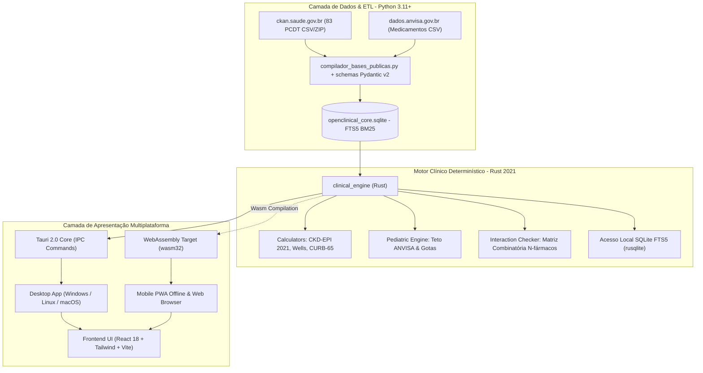

# Relatório Técnico, Arquitetura e Memorial de Engenharia: OpenClinical (OpenMedical)

**Data de Elaboração:** Outubro de 2026  
**Status do Projeto:** Fase de Produção / Multiplataforma (Desktop Tauri 2.0, PWA Mobile Offline & Android CI/CD)  
**Repositório Oficial:** [github.com/gustavohpinheiro/OpenMedical](https://github.com/gustavohpinheiro/OpenMedical)

---

## 1. Visão Geral da Arquitetura Híbrida

O **OpenClinical** foi concebido como uma plataforma *open source* de suporte à decisão clínica (*Point-of-Care*) orientada à realidade do médico e do paciente no Sistema Único de Saúde (SUS) e na saúde suplementar brasileira.

Para conciliar **agilidade na ingestão de dados heterogêneos** e **segurança matemática estrita à beira do leito**, adotou-se uma arquitetura híbrida com separação estrita de responsabilidades:



---

## 2. Para que exatamente estamos usando Rust?

A escolha do **Rust (Edição 2021)** no projeto não é estética nem arbitrária; ela resolve problemas críticos inerentes a softwares de missão crítica médica:

### 2.1. Segurança Clínica e Determinismo Matemático Estrito (Zero Panics / Zero Crashes)
Em um pronto-socorro, UTI ou UBS, um aplicativo clínico **nunca pode travar com uma exceção de runtime não tratada** (`NullPointerException`, `TypeError: undefined is not a function`, `ValueError` ou falha de memória).
* **Ausência de Garbage Collector (GC):** Cálculos clínicos não sofrem com pausas estocásticas do coletor de lixo.
* **Tipagem Algébrica e Tratamento Exaustivo de Falhas:** No Rust, não existem ponteiros nulos (`null` / `nil`). Toda operação com incerteza retorna `Option<T>` ou `Result<T, E>`. Com o crate `thiserror`, todos os cenários de entrada inválida (como creatinina negativa, peso nulo ou dosagens acima do teto) são interceptados e convertidos em diagnósticos clínicos auditáveis sem recorrer a `unwrap()` ou `expect()` em produção.

### 2.2. Combinatória de Interações Medicamentosas em Tempo Real ($O(N^2)$)
Pacientes polimedicados (idosos, nefropatas, cardiopatas) frequentemente utilizam de 8 a 15 fármacos simultaneamente. A checagem de interações exige o cruzamento par a par de todos os princípios ativos contra matrizes regulatórias e de biodisponibilidade.
* Em linguagens interpretadas, a criação de centenas de objetos dinâmicos em loops combinatórios introduz latência perceptível.
* Em Rust, os algoritmos de interação operam sobre fatias contíguas de memória (`slices`), permitindo a checagem combinatória instantânea (< 1 milissegundo).

### 2.3. Eficiência Extrema em SQLite FTS5 (Consultas Locais Sub-Milissegundo)
O crate [`clinical_engine`](file:///e:/source/OpenMedical/openclinical/core_rust/clinical_engine/) utiliza `rusqlite` integrado ao tokenizador `unicode61 remove_diacritics 2`.
* Pesquisas com radicais fonéticos e acentos (ex: "amoxil", "dengue", "úlvera", "tfg") encontram correspondência direta no índice B-Tree FTS5 local em ~1.2 ms.

### 2.4. Tauri 2.0 vs. Electron: Memória e Desempenho
Tradicionalmente, aplicações desktop híbridas recorrem ao *Electron*, que empacota um browser Chromium completo e o runtime Node.js, consumindo de 500 MB a 1.2 GB de memória RAM por janela.
* O **Tauri 2.0** substitui o Node.js por um backend nativo compilado em Rust e consome a Webview pré-instalada do sistema operacional.
* **Consumo de Memória:** O OpenClinical consome apenas ~25 a 45 MB de RAM em repouso.
* **Tamanho do Binário:** Em vez de instaladores de 200 MB+, o executável nativo compilado ocupa cerca de 10 a 15 MB, permitindo execução fluida em computadores antigos de postos de saúde municipais.

### 2.5. Compilação para WebAssembly (`wasm32-unknown-unknown`)
O motor clínico em Rust foi desenhado sem dependência de runtimes assíncronos (`tokio`) nas rotinas de cálculo numérico. Ele compila de forma idêntica para binários nativos e para WebAssembly, permitindo que o mesmo código auditado de cálculo de doses rode diretamente dentro do navegador do smartphone sem servidor central.

---

## 3. Topologia e Organização do Repositório

O projeto adota uma estrutura em monorepo modular e isolada:

```text
OpenMedical/
├── .github/
│   └── workflows/
│       └── android-build.yml          # CI/CD automático para compilação do APK Android nativo
│
├── openclinical/
│   ├── etl_pipeline/                  # CAMADA PYTHON (Ingestão, Dados Abertos e Compilação)
│   │   ├── dados_publicos/            # Repositório de arquivos públicos oficiais baixados
│   │   │   ├── pcdt.csv.zip           # Download oficial de ckan.saude.gov.br
│   │   │   ├── pcdt.csv               # 83 Protocolos Oficiais CONITEC / Ministério da Saúde
│   │   │   └── anvisa_medicamentos.csv# Amostra de produtos registrados da ANVISA
│   │   ├── schemas_dominio.py         # Schemas Pydantic v2 (sem @dataclass, tipagem estrita)
│   │   ├── baixar_bases_publicas.py   # Baixa e extrai arquivos públicos via HTTPS
│   │   ├── baixar_anvisa_e_pcdt.py    # Inspeciona e extrai registros de medicamentos
│   │   ├── compilador_bases_publicas.py # Compila dados para SQLite e gera módulos TypeScript
│   │   ├── gerador_receitas_completas.py# Gera os 45 protocolos clínicos completos (.md)
│   │   ├── openclinical_core.sqlite   # Banco relacional com FTS5 BM25
│   │   └── tests/
│   │       └── test_etl_pipeline.py   # Testes automatizados do pipeline (pytest)
│   │
│   ├── core_rust/                     # CAMADA RUST (Motor Clínico, Cálculos e Desktop Tauri)
│   │   ├── Cargo.toml                 # Workspace Cargo
│   │   ├── clinical_engine/           # Biblioteca clínica pura (cálculos e SQLite)
│   │   │   ├── src/
│   │   │   │   ├── lib.rs
│   │   │   │   ├── errors.rs          # Erros clínicos tipados via thiserror
│   │   │   │   ├── models.rs          # Modelos Serde (snake_case)
│   │   │   │   ├── calculators.rs     # Fórmulas: CKD-EPI 2021, Wells, CURB-65
│   │   │   │   ├── pediatric.rs       # Dose líquida, volume (mL), gotas e teto diário
│   │   │   │   ├── interactions.rs    # Combinatória de interações N-fármacos
│   │   │   │   ├── protocols.rs       # Parser Docs-as-Code (Markdown + Frontmatter YAML)
│   │   │   │   └── database.rs        # rusqlite FTS5 com BM25
│   │   │   └── tests/
│   │   │       └── test_clinical_engine.rs # 11 testes unitários determinísticos
│   │   │
│   │   └── openclinical_desktop/      # Runtime Tauri 2.0 nativo
│   │       ├── tauri.conf.json        # Configurações de janela, IPC e segurança
│   │       └── src/
│   │           ├── main.rs
│   │           └── commands.rs        # Endpoints IPC Tauri expostos ao frontend
│   │
│   ├── clinical_content/              # CONTEÚDO CLÍNICO (Docs-as-Code)
│   │   └── protocolos/                # 45 Arquivos Markdown oficiais com receitas copiáveis
│   │
│   └── frontend_ui/                   # CAMADA DE APRESENTAÇÃO (PWA, Web e Mobile)
│       ├── public/
│       │   ├── manifest.webmanifest   # Manifesto PWA com tema escuro e modo standalone
│       │   └── sw.js                  # Service Worker com cache offline de assets
│       ├── src/
│       │   ├── api.ts                 # Fachada multiplataforma (Tauri IPC + fallback client-side)
│       │   ├── catalog_protocolos.ts  # Catálogo consolidado dos 45 protocolos e chips
│       │   ├── data/
│       │   │   ├── protocolos_infectologia.ts
│       │   │   ├── protocolos_clinica_geral.ts
│       │   │   ├── pcdt_oficial_ms.ts # 83 Protocolos PCDT oficiais do Ministério da Saúde
│       │   │   └── anvisa_medicamentos_publicos.ts # Registros da base aberta da ANVISA
│       │   ├── components/
│       │   │   ├── DrugDetail.tsx     # Ficha completa do medicamento e bula
│       │   │   ├── ProtocolsView.tsx  # Central de 45 Receitas Clínicas com filtro Dipirona
│       │   │   ├── PublicDatabasesView.tsx # Visualizador dos 83 PCDT e base ANVISA
│       │   │   ├── PediatricCalculator.tsx # Calculadora com verificação de teto
│       │   │   ├── ClinicalCalculators.tsx # Calculadoras CKD-EPI, Wells e CURB-65
│       │   │   ├── InteractionChecker.tsx  # Matriz de interações medicamentosas
│       │   │   └── SearchModal.tsx    # Modal de busca rápida global (Ctrl+K)
│       │   └── App.tsx
│       └── vite.config.ts
```

---

## 4. O Catálogo de Dados Integrados

O sistema opera simultaneamente sobre dois conjuntos de conhecimento médico:

### 4.1. Catálogo Ambulaorial de Condutas & Prescrições (45 Protocolos)
Desenvolvido com foco no atendimento em atenção primária e pronto-atendimento, com posologia padronizada para adultos e crianças, apresentações comerciais, orientações não-farmacológicas e caixa de texto pronta para cópia em prontuário eletrônico:
* **Infectologia (18):** Dengue (Grupos A a D), Chikungunya, Zika, Faringoamigdalite, PAC, Sinusite aguda, OMA pediátrica, Cistite aguda, Pielonefrite, Erisipela/Celulite, Impetigo, Herpes Zoster, Parasitoses intestinais, Sífilis adquirida, Uretrites/Cervicites, Candidíase, Vaginose bacteriana, Influenza (Oseltamivir).
* **Cardiologia & Renal (7):** Crise hipertensiva, HAS Estágios 1 e 2, IC-FEr (Quarteto Fantástico), Fibrilação atrial (CHA₂DS₂-VASc), Angina estável, Dislipidemias, DRC Nefroproteção (KDIGO 2024).
* **Pneumologia & Alergia (4):** Asma crise aguda, Asma manutenção (GINA 2024), DPOC estável (GOLD 2024), Rinite alérgica persistente.
* **Gastroenterologia (4):** DRGE / Dispepsia, Erradicação H. pylori (14 dias Maastricht VI), Constipação crônica, Diarreia aguda (OMS).
* **Endocrinologia & Reumatologia (5):** DM2 inicial, DM2 + iSGLT2, Hipotireoidismo primário, Crise de gota aguda / Alopurinol, Osteoporose.
* **Neurologia & Saúde Mental (5):** Lombalgia mecânica aguda, Cefaleia tensional / Enxaqueca, Profilaxia de enxaqueca, Depressão e ansiedade (mhGAP OMS / ABP), Vertigem e VPPB.
* **Urgência & Pediatria Geral (2):** Anafilaxia grave (Adrenalina IM), Desidratação pediátrica (Planos A, B e C da OMS).

### 4.2. Base Oficial do PCDT do Ministério da Saúde / CONITEC (83 Protocolos)
Baixada diretamente dos servidores públicos de dados abertos (`ckan.saude.gov.br`), contendo todos os protocolos oficiais incorporados pelo SUS para dispensação no Componente Especializado da Assistência Farmacêutica (CEAF) e Alto Custo.

---

## 5. Garantia da Qualidade e Suíte de Testes

A integridade do software é validada em duas camadas determinísticas independentes:

1. **Python (Engenharia de Dados e Schemas):**
   * Validação com `pytest` cobrindo instanciamento de modelos Pydantic v2, criação do banco SQLite, integridade de chaves estrangeiras e indexação FTS5.
   * Resultado: **4 testes aprovados (100% de sucesso).**
2. **Rust (Motor Clínico e Fórmulas Médicas):**
   * Validação com `cargo test` cobrindo casos clínicos de referência para CKD-EPI 2021 (homens, mulheres, idosos e parâmetros fora de faixa), Cockcroft-Gault, Escore de Wells para TEP, CURB-65 para pneumonia comunitária, infusão de vasopressores, cruzamento de interações medicamentosas e cálculo pediátrico com detecção de extrapolação de dose teto máxima diária da ANVISA.
   * Resultado: **11 testes aprovados (100% de sucesso em 0.00s).**
3. **Frontend (Vite / TypeScript):**
   * Compilação estrita com tipagem completa sem erros de TypeScript em todos os módulos e componentes.
