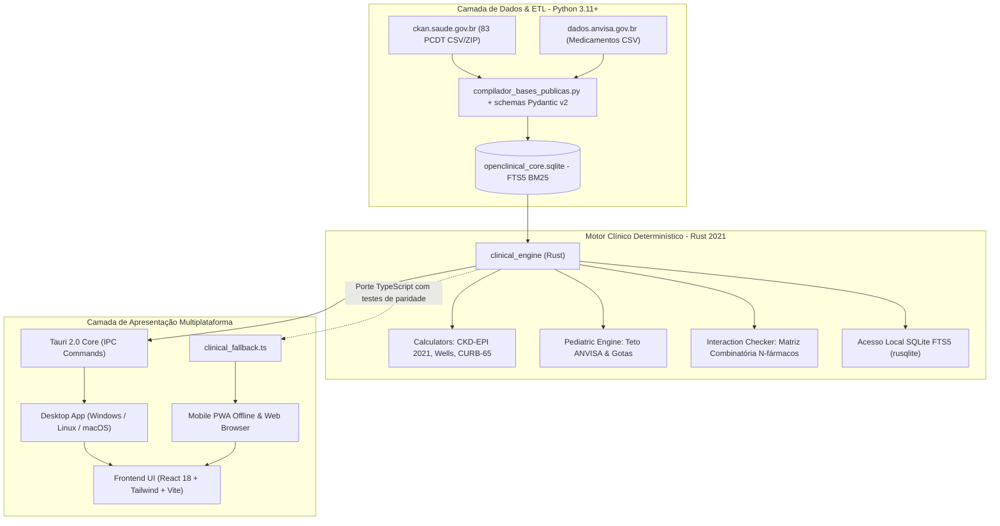

# Relatório Técnico, Arquitetura e Memorial de Engenharia: OpenClinical (OpenMedical)

**Data de Elaboração:** Outubro de 2026  
**Status do Projeto:** Protótipo funcional multiplataforma (Desktop Tauri 2.0, PWA Mobile Offline). **Não validado clinicamente: todo o conteúdo clínico está pendente de revisão por profissional habilitado e não deve ser usado em decisões reais sem essa revisão.**  
**Repositório Oficial:** [github.com/gustavohpinheiro/OpenMedical](https://github.com/gustavohpinheiro/OpenMedical)

---

## 1. Visão Geral da Arquitetura Híbrida

O **OpenClinical** foi concebido como uma plataforma *open source* de suporte à decisão clínica (*Point-of-Care*) orientada à realidade do médico e do paciente no Sistema Único de Saúde (SUS) e na saúde suplementar brasileira.

Para conciliar **agilidade na ingestão de dados heterogêneos** e **segurança matemática estrita à beira do leito**, adotou-se uma arquitetura híbrida com separação estrita de responsabilidades:



---

## 2. Para que exatamente estamos usando Rust?

A escolha do **Rust (Edição 2021)** no projeto não é estética nem arbitrária; ela resolve problemas críticos inerentes a softwares de missão crítica médica:

### 2.1. Segurança Clínica e Determinismo Matemático Estrito (Zero Panics / Zero Crashes)
Em um pronto-socorro, UTI ou UBS, um aplicativo clínico **nunca pode travar com uma exceção de runtime não tratada** (`NullPointerException`, `TypeError: undefined is not a function`, `ValueError` ou falha de memória).
* **Ausência de Garbage Collector (GC):** Cálculos clínicos não sofrem com pausas estocásticas do coletor de lixo.
* **Tipagem Algébrica e Tratamento Exaustivo de Falhas:** No Rust, não existem ponteiros nulos (`null` / `nil`). Toda operação com incerteza retorna `Option<T>` ou `Result<T, E>`. Com o crate `thiserror`, todos os cenários de entrada inválida (como creatinina negativa, peso nulo ou dosagens acima do teto) são interceptados e convertidos em diagnósticos clínicos auditáveis sem recorrer a `unwrap()` ou `expect()` em produção.

### 2.2. Combinatória de Interações Medicamentosas em Tempo Real ($O(N^2)$)
Pacientes polimedicados (idosos, nefropatas, cardiopatas) frequentemente utilizam de 8 a 15 fármacos simultaneamente. A checagem de interações exige o cruzamento par a par de todos os princípios ativos contra matrizes regulatórias e de biodisponibilidade.
* Em linguagens interpretadas, a criação de centenas de objetos dinâmicos em loops combinatórios introduz latência perceptível.
* Em Rust, os algoritmos de interação operam sobre fatias contíguas de memória (`slices`), permitindo a checagem combinatória instantânea (< 1 milissegundo).

### 2.3. Busca local em SQLite FTS5
O crate [`clinical_engine`](openclinical/core_rust/clinical_engine/) utiliza `rusqlite` integrado ao tokenizador `unicode61 remove_diacritics 2` (busca insensível a acentos, coberta por teste automatizado).
* Os tempos de resposta ainda não foram medidos de forma sistemática; qualquer valor de latência deve ser tratado como estimativa até existir benchmark.

### 2.4. Tauri 2.0 vs. Electron: Memória e Desempenho
Tradicionalmente, aplicações desktop híbridas recorrem ao *Electron*, que empacota um browser Chromium completo e o runtime Node.js, consumindo de 500 MB a 1.2 GB de memória RAM por janela.
* O **Tauri 2.0** substitui o Node.js por um backend nativo compilado em Rust e consome a Webview pré-instalada do sistema operacional.
* **Consumo de memória e tamanho do binário:** o Tauri tende a ser muito mais leve que o Electron, mas os números exatos do OpenClinical **não foram medidos** (o banco SQLite empacotado, por si só, tem ~48 MB).

### 2.5. Execução no navegador/PWA
O motor foi desenhado sem `tokio` nas rotinas numéricas e o módulo de banco é isolado por `cfg(target_arch = "wasm32")`, mas **o build WebAssembly não está configurado nem é usado** (o target `wasm32-unknown-unknown` nem está instalado no ambiente de desenvolvimento). No navegador/PWA os cálculos rodam em `frontend_ui/src/clinical_fallback.ts`, um **porte manual** do Rust. Para evitar divergência, `npm test` executa casos de referência idênticos aos testes Rust (`tests/paridade_calculos.test.mjs`). Migrar para WASM real eliminaria a duplicação e é o próximo passo recomendado.

---

## 3. Topologia e Organização do Repositório

O projeto adota uma estrutura em monorepo modular e isolada:

```text
OpenMedical/
├── .github/
│   └── workflows/
│       └── android-build.yml          # CI/CD automático para compilação do APK Android nativo
│
├── openclinical/
│   ├── etl_pipeline/                  # CAMADA PYTHON (Ingestão, Dados Abertos e Compilação)
│   │   ├── dados_publicos/            # Repositório de arquivos públicos oficiais baixados
│   │   │   ├── pcdt.csv.zip           # Download oficial de ckan.saude.gov.br
│   │   │   ├── pcdt.csv               # 83 Protocolos Oficiais CONITEC / Ministério da Saúde
│   │   │   └── anvisa_medicamentos.csv# Amostra de produtos registrados da ANVISA
│   │   ├── schemas_dominio.py         # Schemas Pydantic v2 (sem @dataclass, tipagem estrita)
│   │   ├── baixar_bases_publicas.py   # Baixa e extrai arquivos públicos via HTTPS
│   │   ├── baixar_anvisa_e_pcdt.py    # Inspeciona e extrai registros de medicamentos
│   │   ├── compilador_bases_publicas.py # Compila dados para SQLite e gera módulos TypeScript
│   │   ├── gerador_receitas_completas.py# Fonte única dos 45 protocolos: gera os .md e o módulo TS do frontend
│   │   ├── openclinical_core.sqlite   # Banco relacional com FTS5 BM25
│   │   └── tests/
│   │       └── test_etl_pipeline.py   # Testes automatizados do pipeline (pytest)
│   │
│   ├── core_rust/                     # CAMADA RUST (Motor Clínico, Cálculos e Desktop Tauri)
│   │   ├── Cargo.toml                 # Workspace Cargo
│   │   ├── clinical_engine/           # Biblioteca clínica pura (cálculos e SQLite)
│   │   │   ├── src/
│   │   │   │   ├── lib.rs
│   │   │   │   ├── errors.rs          # Erros clínicos tipados via thiserror
│   │   │   │   ├── models.rs          # Modelos Serde (snake_case)
│   │   │   │   ├── calculators.rs     # Fórmulas: CKD-EPI 2021, Wells, CURB-65
│   │   │   │   ├── pediatric.rs       # Dose líquida, volume (mL), gotas e teto diário
│   │   │   │   ├── interactions.rs    # Combinatória de interações N-fármacos
│   │   │   │   ├── protocols.rs       # Parser Docs-as-Code (Markdown + Frontmatter YAML)
│   │   │   │   └── database.rs        # rusqlite FTS5 com BM25
│   │   │   └── tests/
│   │   │       └── test_clinical_engine.rs # 21 testes (cálculos, parser, FTS5, CMED, Farmácia Popular e banco empacotado)
│   │   │
│   │   └── openclinical_desktop/      # Runtime Tauri 2.0 nativo
│   │       ├── tauri.conf.json        # Janela, IPC, empacotamento do banco como recurso
│   │       ├── gerar_icones.py        # Gera os ícones do desktop e do PWA (Pillow)
│   │       └── src/
│   │           ├── main.rs            # Resolve o banco (OPENCLINICAL_DB_PATH, recursos do app, dev)
│   │           └── commands.rs        # Comandos IPC: busca, bula, CMED, interações, protocolos, cálculos
│   │
│   ├── clinical_content/              # CONTEÚDO CLÍNICO (Docs-as-Code)
│   │   └── protocolos/                # 45 Arquivos Markdown oficiais com receitas copiáveis
│   │
│   └── frontend_ui/                   # CAMADA DE APRESENTAÇÃO (PWA, Web e Mobile)
│       ├── public/
│       │   ├── manifest.webmanifest   # Manifesto PWA com tema escuro e modo standalone
│       │   └── sw.js                  # Service Worker com cache offline de assets
│       ├── src/
│       │   ├── api.ts                 # Fachada multiplataforma (Tauri IPC + fallback client-side)
│       │   ├── catalog_protocolos.ts  # Reexporta o catálogo gerado (data/protocolos_gerados.ts)
│       │   ├── clinical_fallback.ts   # Porte TS do motor para navegador/PWA (testado por paridade)
│       │   ├── data/
│       │   │   ├── protocolos_gerados.ts # GERADO: 45 protocolos, fármacos e categorias
│       │   │   ├── pcdt_oficial_ms.ts # Lista de 83 PCDT/DDT do MS (nome, status, tipo) + resumos curados
│       │   │   └── anvisa_medicamentos_publicos.ts # Registros da base aberta da ANVISA
│       │   ├── components/
│       │   │   ├── DrugDetail.tsx     # Ficha completa do medicamento e bula
│       │   │   ├── ProtocolsView.tsx  # Central de 45 Receitas Clínicas com filtro Dipirona
│       │   │   ├── PublicDatabasesView.tsx # CMED, 83 PCDT e ANVISA (amostras offline + seleção pela busca)
│       │   │   ├── MarkdownSimples.tsx # Renderização segura do Markdown dos protocolos (sem innerHTML)
│       │   │   ├── PediatricCalculator.tsx # Calculadora com verificação de teto
│       │   │   ├── ClinicalCalculators.tsx # Calculadoras CKD-EPI, Wells e CURB-65
│       │   │   ├── InteractionChecker.tsx  # Matriz de interações medicamentosas
│       │   │   └── SearchModal.tsx    # Modal de busca rápida global (Ctrl+K)
│       │   └── App.tsx
│       └── vite.config.ts
```

---

## 4. O Catálogo de Dados Integrados

O sistema opera simultaneamente sobre dois conjuntos de conhecimento médico:

### 4.1. Catálogo Ambulaorial de Condutas & Prescrições (45 Protocolos)
Desenvolvido com foco no atendimento em atenção primária e pronto-atendimento, com posologia padronizada para adultos e crianças, apresentações comerciais, orientações não-farmacológicas e caixa de texto pronta para cópia em prontuário eletrônico:
* **Infectologia (18):** Dengue (Grupos A a D), Chikungunya, Zika, Faringoamigdalite, PAC, Sinusite aguda, OMA pediátrica, Cistite aguda, Pielonefrite, Erisipela/Celulite, Impetigo, Herpes Zoster, Parasitoses intestinais, Sífilis adquirida, Uretrites/Cervicites, Candidíase, Vaginose bacteriana, Influenza (Oseltamivir).
* **Cardiologia & Renal (7):** Crise hipertensiva, HAS Estágios 1 e 2, IC-FEr (Quarteto Fantástico), Fibrilação atrial (CHA₂DS₂-VASc), Angina estável, Dislipidemias, DRC Nefroproteção (KDIGO 2024).
* **Pneumologia & Alergia (4):** Asma crise aguda, Asma manutenção (GINA 2024), DPOC estável (GOLD 2024), Rinite alérgica persistente.
* **Gastroenterologia (4):** DRGE / Dispepsia, Erradicação H. pylori (14 dias Maastricht VI), Constipação crônica, Diarreia aguda (OMS).
* **Endocrinologia & Reumatologia (5):** DM2 inicial, DM2 + iSGLT2, Hipotireoidismo primário, Crise de gota aguda / Alopurinol, Osteoporose.
* **Neurologia & Saúde Mental (5):** Lombalgia mecânica aguda, Cefaleia tensional / Enxaqueca, Profilaxia de enxaqueca, Depressão e ansiedade (mhGAP OMS / ABP), Vertigem e VPPB.
* **Urgência & Pediatria Geral (2):** Anafilaxia grave (Adrenalina IM), Desidratação pediátrica (Planos A, B e C da OMS).

### 4.2. Lista de PCDT/DDT do Ministério da Saúde / CONITEC (83 itens)
O CSV público (`ckan.saude.gov.br`) contém **apenas nome, status e tipo** de cada documento; vários itens estão "Em elaboração/atualização" e há diretrizes (DDT) que não são PCDT. Os campos clínicos (CIDs, fármacos, conduta, receita) existem somente para 23 itens (`conteudo_curado = true`), são **resumos escritos pelo projeto** (não o texto do PCDT) e estão pendentes de revisão clínica. Para os demais 60 itens esses campos ficam vazios.

### 4.3. Formulário Terapêutico Nacional (FTN 2010) e RENAME 2024
`etl_pipeline/extrator_formulario_terapeutico.py` baixa os PDFs oficiais do Ministério da Saúde (BVS/MS) para `dados_publicos/` e extrai:
* **346 monografias do FTN 2010** (Portaria MS nº 4.004/2010): apresentações, indicações, contraindicações, precauções, esquemas de administração por população e indicação, farmacocinética, efeitos adversos, **1.436 interações**, orientações ao paciente e aspectos farmacêuticos. A separação usa a tipografia do PDF (título, seção, população em negrito, indicação em itálico). Marcadores e parênteses em fonte regular no meio de linhas negritas/itálicas são ignorados na classificação, e rótulos de população diagramados sem negrito ("• Adultos") ou escritos no próprio item ("Neonatos: 5 mg/kg...") também são reconhecidos, para que dose de adulto nunca fique rotulada como pediátrica. O FTN permite reprodução citando a fonte, sem fins comerciais; cada monografia indica a página de origem.
* **915 apresentações da RENAME 2024** (Portaria GM/MS nº 6.324/2024): concentração, forma, componente (Básico/Estratégico/Especializado), ATC e AWaRe, lidas pela estrutura de tabela do PDF (célula de denominação vazia = mesma denominação da linha anterior). A leitura sequencial anterior colava cabeçalhos de página e concentrações nos nomes e perdia itens, como a metformina. 212 monografias do FTN são associadas, inclusive títulos com sais alternativos ("succinato de metoprolol ou tartarato de metoprolol").
* **Disponível no SUS:** a lista, a monografia, a calculadora e o detalhe de produto comercial marcam "Disponível no SUS (RENAME 2024 · componente)" ou "Fora do SUS ambulatorial". A RENAME é a lista ambulatorial: medicamentos de uso hospitalar ou oncológico que não constam dela podem ser fornecidos por outras vias do SUS.
* **Apresentações comerciais:** cada monografia tem a aba "Apresentações comerciais" com todos os produtos da CMED do mesmo princípio ativo ou associação (ex.: 130 apresentações de 19 produtos de amoxicilina + clavulanato), com via, tipo (referência/genérico/similar), PMC e gratuidade no Farmácia Popular; por padrão só as vias descritas no FTN.
* **Receita pronta:** na tela "Medicamentos & Receitas" o usuário escolhe a apresentação e o esquema do FTN; o texto da receita (editável) traz via, posologia, orientações, tipo de receituário (Portaria 344/98 para as substâncias listadas, RDC 20/2011 para antibacterianos) e a página do FTN.
* **Dose pediátrica:** o extrator estrutura em mg/kg/dia só os casos inequívocos. A calculadora (`frontend_ui/src/pediatria_ftn.ts`) aceita qualquer um dos 346 fármacos: lista os esquemas pediátricos da monografia e preenche dose, modo (mg/kg **por dia** ou **por tomada**), intervalo e teto só quando o texto é inequívoco. Dose por infusão (mg/kg/h), mais de uma dose no mesmo texto ("ataque" + "manutenção") ou intervalo em faixa ("a cada 4 a 6 horas") ficam para o médico informar, e a calculadora não calcula até que ele informe. "A cada N horas" sozinho não define dose por tomada: o FTN escreve "20 a 90 mg/kg de amoxicilina, a cada 8 ou 12 horas" querendo dose diária; só "dose única", "por dose" ou "por tomada" contam. Associações (amoxicilina + clavulanato) usam a concentração do componente em que a dose é expressa, e as formulações vêm marcadas como SUS (RENAME), FTN ou comerciais (CMED, via oral líquida). "Dose única" é preservada no texto copiado para o prontuário. Sem formulação líquida (comprimido), o resultado sai em mg, sem volume. Doses máximas só viram teto diário quando o texto diz "diária" ou "/dia".
* **Limite:** o FTN é de 2010; condutas mais recentes (PCDT, diretrizes de sociedades) podem diferir.

### 4.4. Preço máximo e Farmácia Popular
`clinical_engine::pharmacy_pricing` (e o porte `frontend_ui/src/farmacia_popular.ts`, com paridade testada) reúne para cada apresentação da CMED:
* **PMC oficial** (coluna com ICMS de 18%) e PMC por unidade. É o único valor monetário exibido: o projeto **não** tem acesso aos preços praticados pelas farmácias e não os estima.
* **Farmácia Popular:** gratuidade conferida por substância **e** dose contra o elenco divulgado pelo Ministério da Saúde em 13/02/2025 (todos os itens gratuitos desde então, sem copagamento). Associações e doses fora do elenco não contam.
* **Links de busca** (Consulta Remédios, Ultrafarma, Drogasil, Droga Raia, Drogaria São Paulo, Pacheco, Pague Menos, Panvel) para o usuário conferir o preço real.

O elenco do Farmácia Popular muda por portaria; a data de referência fica em `REFERENCIA_ELENCO_FARMACIA_POPULAR` e deve ser revisada.

### 4.5. Posologia e bula dos produtos comerciais
`frontend_ui/src/ligacao_ftn.ts` liga cada apresentação da CMED à monografia do FTN:
* **Princípio ativo:** sal, hidratação e ordem da associação são ignorados ("CLORIDRATO DE CIPROFLOXACINO MONOIDRATADO" → ciprofloxacino; "CLAVULANATO DE POTÁSSIO;AMOXICILINA" = "amoxicilina + clavulanato"). Associação só casa com a mesma associação; sal mineral em que o íon é o fármaco (cloreto de potássio, carbonato de lítio) fica inteiro.
* **Via:** a via da apresentação (abreviaturas ANVISA: "SOL INJ", "SUS OFT", "CREM DERM", "COM REV"...) precisa estar entre as apresentações descritas na própria monografia. Pomada de betametasona não recebe a posologia da betametasona injetável, colírio de prednisolona não recebe a da solução oral, e as gotas de dipirona ficam sem posologia porque o FTN só descreve a dipirona injetável. Forma não reconhecida não recebe posologia.
* **Cobertura:** 5.877 das 26.635 apresentações (254 monografias) recebem a posologia do FTN, com aviso para conferir concentração e forma (ex.: liberação prolongada) e botão para a monografia completa e a receita.
* **Bula oficial:** todo produto (CMED, registros ANVISA e bulas estruturadas) tem link para o Bulário Eletrônico da ANVISA pelo registro do produto (9 primeiros dígitos) ou, sem registro, pelo nome. A consulta exige internet e o site da ANVISA pode pedir verificação humana (Cloudflare). No app desktop os links abrem no navegador do sistema (permissão `opener:default` em `openclinical_desktop/capabilities/default.json`).
* **Busca:** o índice FTS5 tem uma linha por apresentação CMED (26.635); na busca global, monografias, bulas e protocolos vêm antes das apresentações comerciais.
* **Nome clicável:** em protocolos, PCDT, interações, monografias, registros ANVISA e tela de preço, o nome do medicamento abre, nesta ordem, a bula estruturada do app (mesmo princípio ativo), a monografia do FTN, a apresentação CMED de mesmo nome ou, por fim, a busca global já preenchida.

### 4.6. Atualização diária das bases e índice do Bulário
`clinical_engine::atualizador` mantém atualizadas, a partir dos dados abertos da ANVISA, as três bases que alimentam receitas, preços e bulas:

| Fonte | Arquivo | Tabela |
|---|---|---|
| Preços máximos e apresentações (CMED) | `dados.anvisa.gov.br/dados/TA_PRECO_MEDICAMENTO.csv` | `catalogo_nacional_medicamentos_cmed` + índice de busca |
| Medicamentos registrados | `dados.anvisa.gov.br/dados/DADOS_ABERTOS_MEDICAMENTOS.csv` | `remedios_brasil_anvisa_completo` |
| Índice do Bulário Eletrônico | `dados.anvisa.gov.br/dados/CONSULTAS/DOCUMENTOS/TA_CONSULTA_BULA_PRODUTO.CSV` | `bulas_anvisa_indice` (8.823 produtos) |

* **Quando roda:** o app desktop verifica de hora em hora se passou um dia desde a última consulta e, se passou, atualiza em segundo plano; a tela de bases públicas mostra a situação de cada fonte e tem o botão "Verificar agora". Fora do app, `openclinical_cli atualizar [banco] [--forcar]` faz o mesmo e pode ir no agendador do sistema.
* **Sem desperdício:** a requisição é condicional (ETag / Last-Modified); sem mudança na ANVISA nada é baixado de novo nem regravado.
* **Sem perda de dados:** cada fonte é aplicada em uma transação, e o arquivo novo só substitui a tabela se tiver ao menos metade das linhas atuais (e um mínimo absoluto). Download truncado ou mudança de formato é registrado como erro, e os dados atuais são mantidos. As consultas do app esperam a transação terminar (`busy_timeout`).
* **Banco gravável:** no app instalado o banco empacotado fica em pasta somente leitura; na primeira execução de cada versão ele é copiado para a pasta de dados do app, onde o atualizador grava. Em desenvolvimento, o atualizador grava no próprio arquivo do repositório.
* **Bula vigente:** `consultar_bula_anvisa` devolve, pelo registro do produto, a data e o expediente da bula vigente e a empresa; a interface mostra "bula vigente de DD/MM/AAAA" junto ao botão do Bulário.
* **Texto da bula:** a API interna do Bulário (`consultas.anvisa.gov.br/api`) recusa chamadas automatizadas (HTTP 403 do firewall da ANVISA), e o Portal de APIs oficial não publica endpoint de bula (ver 4.7). O projeto não contorna o bloqueio: o texto da bula é aberto no Bulário pelo navegador, e o índice oficial em dados abertos informa qual versão está vigente.

### 4.7. Portal de APIs da ANVISA (credencial do usuário)
`clinical_engine::api_anvisa` integra o Portal de APIs da ANVISA (api.anvisa.gov.br):
* **Autenticação:** OAuth2 *client credentials* no Keycloak da ANVISA (`acesso.prd.apps.anvisa.gov.br/auth/realms/externo/protocol/openid-connect/token`). O Client ID é o CPF do titular da conta gov.br; o Client Secret é gerado por ele em `api.anvisa.gov.br/client-manage` ("Criar Client" / "Regenerar Secret").
* **Serviços publicados** (gateway `api-gateway.prd.apps.anvisa.gov.br`): Consultas Externas (produtos para saúde, UDI, certificados de boas práticas, filas), SNGPC, Lista CMED e SNCR (numeração de Notificação de Receita e de Receita de Controle Especial). **Não há endpoint de bula.** O teste de conexão confere a Lista CMED e as Consultas Externas; o SNCR nunca é chamado em teste, porque emite numeração oficial de receita.
* **Cadastro:** a tela de bases públicas traz um tutorial passo a passo e um botão que abre o portal no navegador. O login gov.br é feito pela própria pessoa: o app não automatiza o login nem lê a página do portal, porque isso exigiria manipular a senha gov.br. A pessoa cola o Client ID e o Client Secret.
* **Armazenamento:** as credenciais ficam no cofre do sistema operacional (Gerenciador de Credenciais do Windows, Keychain no macOS, Secret Service no Linux), persistentes entre execuções. Não ficam em cookie, `localStorage` ou arquivo do app. O secret não volta para a interface, e o CPF aparece mascarado. No navegador/PWA não há cadastro: a ANVISA bloqueia essas chamadas por CORS.
* **Teste fora do app:** `ANVISA_CLIENT_ID=... ANVISA_CLIENT_SECRET=... openclinical_cli testar-api-anvisa`.
* **Firewall:** sem token, o firewall da ANVISA barra chamadas fora do navegador às Consultas Externas e à Lista CMED; com token válido as Consultas Externas respondem normalmente. Se houver bloqueio, o teste mostra o Ray ID para um chamado junto à ANVISA.
* **Validado com credencial real (28/10/2026, teste rodado pelo titular):** token emitido; Consultas Externas acessíveis (59 operações). A Lista CMED respondeu 404 no endereço da especificação. A configuração pública do portal traz `FEATURE_FLAG_CMED: "false"`, o que indica que o serviço ainda não foi publicado; o teste tenta `/v3/api-docs`, `/v2/api-docs` e `/api-docs` e informa "Não publicado pela ANVISA" quando nenhum existe.

---

## 5. Garantia da Qualidade e Suíte de Testes

A integridade do software é validada em duas camadas determinísticas independentes:

1. **Python (Engenharia de Dados e Schemas):**
   * Validação com `pytest` cobrindo instanciamento de modelos Pydantic v2, criação do banco SQLite, integridade de chaves estrangeiras e indexação FTS5.
   * Resultado: **14 testes aprovados** (inclui banco isolado semeado do zero, consistência dos 45 protocolos com o gerador, ausência de posologia genérica nas receitas, PCDT sem CIDs inventados, leitura UTF-8 da CMED, igualdade entre os dados de demonstração do frontend e o seed, extração do FTN e da RENAME 2024 (por tabela) a partir dos PDFs oficiais, com regressões de população/indicação em losartana, azitromicina, medroxiprogesterona e rifampicina, e as regras de segurança da dose pediátrica estruturada).
2. **Rust (Motor Clínico e Fórmulas Médicas):**
   * Validação com `cargo test` cobrindo casos clínicos de referência para CKD-EPI 2021 (homens, mulheres, idosos e parâmetros fora de faixa), Cockcroft-Gault, Escore de Wells para TEP, CURB-65 para pneumonia comunitária, infusão de vasopressores, cruzamento de interações medicamentosas e cálculo pediátrico com detecção de extrapolação de dose teto máxima diária da ANVISA.
   * Resultado: **24 testes aprovados** (inclui normalização, mascaramento e mensagens de erro da credencial do Portal de APIs da ANVISA, leitura dos arquivos da ANVISA pelo atualizador, recusa de arquivo truncado ou de formato desconhecido sem apagar dados, consulta ao índice de bulas, dose pediátrica de forma sólida sem volume, limites do escore de Wells, entradas inválidas, busca FTS5 sem acentos / termos só com pontuação, consulta CMED, gratuidade do Farmácia Popular por substância e dose, e um teste que exercita o banco realmente empacotado no app: bula, interações, busca por tipo de registro, todas as apresentações CMED indexadas e monografia do FTN antes das embalagens).
3. **Frontend (Vite / TypeScript):**
   * `npm run typecheck` (tsc estrito) sem erros; `npm test` executa 12 testes (disponibilidade no SUS pela RENAME, associações na calculadora, paridade dos cálculos e do Farmácia Popular com os casos de referência do Rust, a ligação produto → monografia do FTN por princípio ativo e via, e a leitura dos esquemas pediátricos do FTN pela calculadora); `npm run build` gera o bundle de produção.
   * Tailwind CSS e as fontes (Plus Jakarta Sans, JetBrains Mono) são empacotados no build: a interface não depende de CDN e renderiza igual offline (PWA e desktop).

## 6. Limitações Conhecidas

* **Sem validação clínica formal.** Protocolos, bulas, interações e resumos de PCDT foram redigidos pelo projeto; todos carregam `status_revisao_clinica: pendente_revisao_por_profissional_habilitado`.
* **Cobertura farmacológica:** 346 medicamentos com posologia oficial do FTN 2010 (com 1.436 interações descritas, sem graduação de gravidade pela fonte) e bulas estruturadas próprias para 10 princípios ativos. A ausência de alerta de interação **não** significa ausência de interação (a interface informa isso).
* **Produtos das bulas estruturadas:** 9 dos 13 produtos têm registro e PMC conferidos na tabela CMED; Losec Mups, Zocor, Levophed e o comprimido de dipirona do seed não constam da tabela atual e aparecem como "registro não localizado".
* **Catálogo CMED/ANVISA** (26.635 apresentações CMED; ~85 mil registros ANVISA ativos) traz identificação e preço. Posologia só existe quando o princípio ativo e a via têm monografia no FTN 2010 (5.877 apresentações); para os demais (a maioria dos lançamentos recentes e das associações comerciais) a posologia está apenas na bula oficial, aberta pelo link do Bulário Eletrônico (requer internet). A ANVISA não oferece download em massa das bulas e bloqueia o acesso automatizado à API do Bulário, por isso o texto das bulas não é empacotado; o app sabe apenas qual versão está vigente (índice em dados abertos).
* **Atualizador diário** só no app desktop e na CLI; no navegador/PWA as amostras dos catálogos acompanham a versão do app. O atualizador foi validado pela CLI contra os arquivos reais da ANVISA; o ciclo dentro do app instalado (thread, evento para a interface) não foi exercitado num build empacotado.
* **Dados de demonstração duplicados no frontend** (`MOCK_MEDICAMENTOS` e `MOCK_INTERACOES` em `api.ts`) repetem o seed Python. Um teste garante que gravidades e formas farmacêuticas coincidem, mas os textos ainda são cópias e o ideal é gerá-los a partir do seed.
* **No navegador/PWA** os catálogos CMED e ANVISA são amostras (1.855 e 250 registros); o catálogo completo só é pesquisável no app desktop. No app instalado, a lista de protocolos vem do catálogo gerado embutido no frontend (os `.md` não são empacotados como recurso).
* O build Android (`.github/workflows/android-build.yml`) não executa `cargo tauri android init` e não foi validado.
