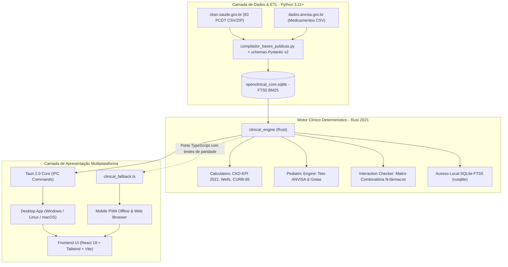

# Relatório Técnico, Arquitetura e Memorial de Engenharia: OpenClinical (OpenMedical)

**Data de Elaboração:** Outubro de 2026  
**Status do Projeto:** Protótipo funcional multiplataforma (Desktop Tauri 2.0, PWA Mobile Offline). **Não validado clinicamente: todo o conteúdo clínico está pendente de revisão por profissional habilitado e não deve ser usado em decisões reais sem essa revisão.**  
**Repositório Oficial:** [github.com/gustavohpinheiro/OpenMedical](https://github.com/gustavohpinheiro/OpenMedical)

---

## 1. Visão Geral da Arquitetura Híbrida

O **OpenClinical** foi concebido como uma plataforma *open source* de suporte à decisão clínica (*Point-of-Care*) orientada à realidade do médico e do paciente no Sistema Único de Saúde (SUS) e na saúde suplementar brasileira.

Para conciliar **agilidade na ingestão de dados heterogêneos** e **segurança matemática estrita à beira do leito**, adotou-se uma arquitetura híbrida com separação estrita de responsabilidades:



---

## 2. Para que exatamente estamos usando Rust?

A escolha do **Rust (Edição 2021)** no projeto não é estética nem arbitrária; ela resolve problemas críticos inerentes a softwares de missão crítica médica:

### 2.1. Segurança Clínica e Determinismo Matemático Estrito (Zero Panics / Zero Crashes)
Em um pronto-socorro, UTI ou UBS, um aplicativo clínico **nunca pode travar com uma exceção de runtime não tratada** (`NullPointerException`, `TypeError: undefined is not a function`, `ValueError` ou falha de memória).
* **Ausência de Garbage Collector (GC):** Cálculos clínicos não sofrem com pausas estocásticas do coletor de lixo.
* **Tipagem Algébrica e Tratamento Exaustivo de Falhas:** No Rust, não existem ponteiros nulos (`null` / `nil`). Toda operação com incerteza retorna `Option<T>` ou `Result<T, E>`. Com o crate `thiserror`, todos os cenários de entrada inválida (como creatinina negativa, peso nulo ou dosagens acima do teto) são interceptados e convertidos em diagnósticos clínicos auditáveis sem recorrer a `unwrap()` ou `expect()` em produção.

### 2.2. Combinatória de Interações Medicamentosas em Tempo Real ($O(N^2)$)
Pacientes polimedicados (idosos, nefropatas, cardiopatas) frequentemente utilizam de 8 a 15 fármacos simultaneamente. A checagem de interações exige o cruzamento par a par de todos os princípios ativos contra matrizes regulatórias e de biodisponibilidade.
* Em linguagens interpretadas, a criação de centenas de objetos dinâmicos em loops combinatórios introduz latência perceptível.
* Em Rust, os algoritmos de interação operam sobre fatias contíguas de memória (`slices`), permitindo a checagem combinatória instantânea (< 1 milissegundo).

### 2.3. Busca local em SQLite FTS5
O crate [`clinical_engine`](openclinical/core_rust/clinical_engine/) utiliza `rusqlite` integrado ao tokenizador `unicode61 remove_diacritics 2` (busca insensível a acentos, coberta por teste automatizado).
* Os tempos de resposta ainda não foram medidos de forma sistemática; qualquer valor de latência deve ser tratado como estimativa até existir benchmark.

### 2.4. Tauri 2.0 vs. Electron: Memória e Desempenho
Tradicionalmente, aplicações desktop híbridas recorrem ao *Electron*, que empacota um browser Chromium completo e o runtime Node.js, consumindo de 500 MB a 1.2 GB de memória RAM por janela.
* O **Tauri 2.0** substitui o Node.js por um backend nativo compilado em Rust e consome a Webview pré-instalada do sistema operacional.
* **Consumo de memória e tamanho do binário:** o Tauri tende a ser muito mais leve que o Electron, mas os números exatos do OpenClinical **não foram medidos** (o banco SQLite empacotado, por si só, tem ~48 MB).

### 2.5. Execução no navegador/PWA
O motor foi desenhado sem `tokio` nas rotinas numéricas e o módulo de banco é isolado por `cfg(target_arch = "wasm32")`, mas **o build WebAssembly não está configurado nem é usado** (o target `wasm32-unknown-unknown` nem está instalado no ambiente de desenvolvimento). No navegador/PWA os cálculos rodam em `frontend_ui/src/clinical_fallback.ts`, um **porte manual** do Rust. Para evitar divergência, `npm test` executa casos de referência idênticos aos testes Rust (`tests/paridade_calculos.test.mjs`). Migrar para WASM real eliminaria a duplicação e é o próximo passo recomendado.

---

## 3. Topologia e Organização do Repositório

O projeto adota uma estrutura em monorepo modular e isolada:

```text
OpenMedical/
├── .github/
│   └── workflows/
│       └── android-build.yml          # CI/CD automático para compilação do APK Android nativo
│
├── openclinical/
│   ├── etl_pipeline/                  # CAMADA PYTHON (Ingestão, Dados Abertos e Compilação)
│   │   ├── dados_publicos/            # Repositório de arquivos públicos oficiais baixados
│   │   │   ├── pcdt.csv.zip           # Download oficial de ckan.saude.gov.br
│   │   │   ├── pcdt.csv               # 83 Protocolos Oficiais CONITEC / Ministério da Saúde
│   │   │   └── anvisa_medicamentos.csv# Amostra de produtos registrados da ANVISA
│   │   ├── schemas_dominio.py         # Schemas Pydantic v2 (sem @dataclass, tipagem estrita)
│   │   ├── baixar_bases_publicas.py   # Baixa e extrai arquivos públicos via HTTPS
│   │   ├── baixar_anvisa_e_pcdt.py    # Inspeciona e extrai registros de medicamentos
│   │   ├── compilador_bases_publicas.py # Compila dados para SQLite e gera módulos TypeScript
│   │   ├── gerador_receitas_completas.py# Fonte única dos 45 protocolos: gera os .md e o módulo TS do frontend
│   │   ├── openclinical_core.sqlite   # Banco relacional com FTS5 BM25
│   │   └── tests/
│   │       └── test_etl_pipeline.py   # Testes automatizados do pipeline (pytest)
│   │
│   ├── core_rust/                     # CAMADA RUST (Motor Clínico, Cálculos e Desktop Tauri)
│   │   ├── Cargo.toml                 # Workspace Cargo
│   │   ├── clinical_engine/           # Biblioteca clínica pura (cálculos e SQLite)
│   │   │   ├── src/
│   │   │   │   ├── lib.rs
│   │   │   │   ├── errors.rs          # Erros clínicos tipados via thiserror
│   │   │   │   ├── models.rs          # Modelos Serde (snake_case)
│   │   │   │   ├── calculators.rs     # Fórmulas: CKD-EPI 2021, Wells, CURB-65
│   │   │   │   ├── pediatric.rs       # Dose líquida, volume (mL), gotas e teto diário
│   │   │   │   ├── interactions.rs    # Combinatória de interações N-fármacos
│   │   │   │   ├── protocols.rs       # Parser Docs-as-Code (Markdown + Frontmatter YAML)
│   │   │   │   └── database.rs        # rusqlite FTS5 com BM25
│   │   │   └── tests/
│   │   │       └── test_clinical_engine.rs # 18 testes (cálculos, parser, FTS5, CMED e banco empacotado)
│   │   │
│   │   └── openclinical_desktop/      # Runtime Tauri 2.0 nativo
│   │       ├── tauri.conf.json        # Janela, IPC, empacotamento do banco como recurso
│   │       ├── gerar_icones.py        # Gera os ícones do desktop e do PWA (Pillow)
│   │       └── src/
│   │           ├── main.rs            # Resolve o banco (OPENCLINICAL_DB_PATH, recursos do app, dev)
│   │           └── commands.rs        # Comandos IPC: busca, bula, CMED, interações, protocolos, cálculos
│   │
│   ├── clinical_content/              # CONTEÚDO CLÍNICO (Docs-as-Code)
│   │   └── protocolos/                # 45 Arquivos Markdown oficiais com receitas copiáveis
│   │
│   └── frontend_ui/                   # CAMADA DE APRESENTAÇÃO (PWA, Web e Mobile)
│       ├── public/
│       │   ├── manifest.webmanifest   # Manifesto PWA com tema escuro e modo standalone
│       │   └── sw.js                  # Service Worker com cache offline de assets
│       ├── src/
│       │   ├── api.ts                 # Fachada multiplataforma (Tauri IPC + fallback client-side)
│       │   ├── catalog_protocolos.ts  # Reexporta o catálogo gerado (data/protocolos_gerados.ts)
│       │   ├── clinical_fallback.ts   # Porte TS do motor para navegador/PWA (testado por paridade)
│       │   ├── data/
│       │   │   ├── protocolos_gerados.ts # GERADO: 45 protocolos, fármacos e categorias
│       │   │   ├── pcdt_oficial_ms.ts # Lista de 83 PCDT/DDT do MS (nome, status, tipo) + resumos curados
│       │   │   └── anvisa_medicamentos_publicos.ts # Registros da base aberta da ANVISA
│       │   ├── components/
│       │   │   ├── DrugDetail.tsx     # Ficha completa do medicamento e bula
│       │   │   ├── ProtocolsView.tsx  # Central de 45 Receitas Clínicas com filtro Dipirona
│       │   │   ├── PublicDatabasesView.tsx # CMED, 83 PCDT e ANVISA (amostras offline + seleção pela busca)
│       │   │   ├── MarkdownSimples.tsx # Renderização segura do Markdown dos protocolos (sem innerHTML)
│       │   │   ├── PediatricCalculator.tsx # Calculadora com verificação de teto
│       │   │   ├── ClinicalCalculators.tsx # Calculadoras CKD-EPI, Wells e CURB-65
│       │   │   ├── InteractionChecker.tsx  # Matriz de interações medicamentosas
│       │   │   └── SearchModal.tsx    # Modal de busca rápida global (Ctrl+K)
│       │   └── App.tsx
│       └── vite.config.ts
```

---

## 4. O Catálogo de Dados Integrados

O sistema opera simultaneamente sobre dois conjuntos de conhecimento médico:

### 4.1. Catálogo Ambulaorial de Condutas & Prescrições (45 Protocolos)
Desenvolvido com foco no atendimento em atenção primária e pronto-atendimento, com posologia padronizada para adultos e crianças, apresentações comerciais, orientações não-farmacológicas e caixa de texto pronta para cópia em prontuário eletrônico:
* **Infectologia (18):** Dengue (Grupos A a D), Chikungunya, Zika, Faringoamigdalite, PAC, Sinusite aguda, OMA pediátrica, Cistite aguda, Pielonefrite, Erisipela/Celulite, Impetigo, Herpes Zoster, Parasitoses intestinais, Sífilis adquirida, Uretrites/Cervicites, Candidíase, Vaginose bacteriana, Influenza (Oseltamivir).
* **Cardiologia & Renal (7):** Crise hipertensiva, HAS Estágios 1 e 2, IC-FEr (Quarteto Fantástico), Fibrilação atrial (CHA₂DS₂-VASc), Angina estável, Dislipidemias, DRC Nefroproteção (KDIGO 2024).
* **Pneumologia & Alergia (4):** Asma crise aguda, Asma manutenção (GINA 2024), DPOC estável (GOLD 2024), Rinite alérgica persistente.
* **Gastroenterologia (4):** DRGE / Dispepsia, Erradicação H. pylori (14 dias Maastricht VI), Constipação crônica, Diarreia aguda (OMS).
* **Endocrinologia & Reumatologia (5):** DM2 inicial, DM2 + iSGLT2, Hipotireoidismo primário, Crise de gota aguda / Alopurinol, Osteoporose.
* **Neurologia & Saúde Mental (5):** Lombalgia mecânica aguda, Cefaleia tensional / Enxaqueca, Profilaxia de enxaqueca, Depressão e ansiedade (mhGAP OMS / ABP), Vertigem e VPPB.
* **Urgência & Pediatria Geral (2):** Anafilaxia grave (Adrenalina IM), Desidratação pediátrica (Planos A, B e C da OMS).

### 4.2. Lista de PCDT/DDT do Ministério da Saúde / CONITEC (83 itens)
O CSV público (`ckan.saude.gov.br`) contém **apenas nome, status e tipo** de cada documento; vários itens estão "Em elaboração/atualização" e há diretrizes (DDT) que não são PCDT. Os campos clínicos (CIDs, fármacos, conduta, receita) existem somente para 23 itens (`conteudo_curado = true`), são **resumos escritos pelo projeto** (não o texto do PCDT) e estão pendentes de revisão clínica. Para os demais 60 itens esses campos ficam vazios.

---

## 5. Garantia da Qualidade e Suíte de Testes

A integridade do software é validada em duas camadas determinísticas independentes:

1. **Python (Engenharia de Dados e Schemas):**
   * Validação com `pytest` cobrindo instanciamento de modelos Pydantic v2, criação do banco SQLite, integridade de chaves estrangeiras e indexação FTS5.
   * Resultado: **10 testes aprovados** (inclui banco isolado semeado do zero, consistência dos 45 protocolos com o gerador, ausência de posologia genérica nas receitas, PCDT sem CIDs inventados, leitura UTF-8 da CMED e igualdade entre os dados de demonstração do frontend e o seed).
2. **Rust (Motor Clínico e Fórmulas Médicas):**
   * Validação com `cargo test` cobrindo casos clínicos de referência para CKD-EPI 2021 (homens, mulheres, idosos e parâmetros fora de faixa), Cockcroft-Gault, Escore de Wells para TEP, CURB-65 para pneumonia comunitária, infusão de vasopressores, cruzamento de interações medicamentosas e cálculo pediátrico com detecção de extrapolação de dose teto máxima diária da ANVISA.
   * Resultado: **18 testes aprovados** (inclui limites do escore de Wells, entradas inválidas, busca FTS5 sem acentos / termos só com pontuação, consulta CMED e um teste que exercita o banco realmente empacotado no app: bula, interações e busca por tipo de registro).
3. **Frontend (Vite / TypeScript):**
   * `npm run typecheck` (tsc estrito) sem erros; `npm test` executa 8 testes de paridade dos cálculos contra os casos de referência do Rust; `npm run build` gera o bundle de produção.
   * Tailwind CSS e as fontes (Plus Jakarta Sans, JetBrains Mono) são empacotados no build: a interface não depende de CDN e renderiza igual offline (PWA e desktop).

## 6. Limitações Conhecidas

* **Sem validação clínica formal.** Protocolos, bulas, interações e resumos de PCDT foram redigidos pelo projeto; todos carregam `status_revisao_clinica: pendente_revisao_por_profissional_habilitado`.
* **Cobertura farmacológica mínima:** bulas estruturadas para 10 princípios ativos, 13 apresentações e 5 interações. A ausência de alerta de interação **não** significa ausência de interação (a interface agora informa isso).
* **Catálogo CMED/ANVISA** (26.635 apresentações CMED; ~85 mil registros ANVISA ativos) traz identificação e preço, **sem posologia**: os modelos de receita desses registros são esqueletos com campos `[PREENCHER]`.
* **Dados de demonstração duplicados no frontend** (`MOCK_MEDICAMENTOS` e `MOCK_INTERACOES` em `api.ts`) repetem o seed Python. Um teste garante que gravidades e formas farmacêuticas coincidem, mas os textos ainda são cópias e o ideal é gerá-los a partir do seed.
* **No navegador/PWA** os catálogos CMED e ANVISA são amostras (1.855 e 250 registros); o catálogo completo só é pesquisável no app desktop. No app instalado, a lista de protocolos vem do catálogo gerado embutido no frontend (os `.md` não são empacotados como recurso).
* O build Android (`.github/workflows/android-build.yml`) não executa `cargo tauri android init` e não foi validado.
