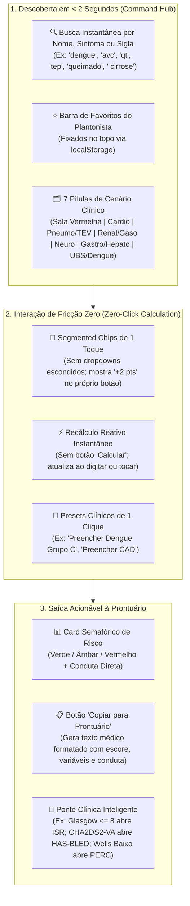
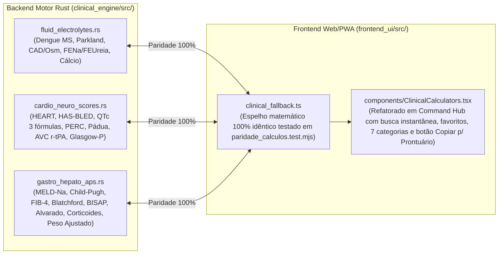

# Mapa Geral & Plano de Execução: Hub de Calculadoras Clínicas de Alta Usabilidade (OpenClinical 2.1)

> [!IMPORTANT]
> **Escopo deste Documento:**
> Este documento mapeia todas as calculadoras médicas essenciais para Pronto-Socorro (Sala Vermelha/UPA), UTI, Enfermaria e Atenção Primária (UBS/SUS), e especifica uma **arquitetura de usabilidade Point-of-Care de fricção zero** para que o médico acesse qualquer cálculo em menos de 3 segundos e cole o resultado direto no prontuário.

---

## 1. Diagnóstico de Usabilidade: Como Evitar a "Poluição de Abas"

Quando um sistema médico cresce de 10 para **36 calculadoras clínicas**, colocar todas em botões horizontais lado a lado inviabiliza o uso no plantão. Para que o módulo seja **extremamente fácil e rápido de usar**, o plano adota o padrão **Clinical Command Hub** baseado em 5 regras de ergonomia cognitiva:

### As 5 Regras de Ouro de Usabilidade (UX Médica)
1. **Zero Botão "Calcular" (Reatividade Instantânea):** Todas as calculadoras recalculam automaticamente (`useMemo` / `useEffect`) a cada tecla ou clique em critério.
2. **Proibição de `<select>` Escondido em Escores Pontuados:** Critérios como *HEART Score*, *Glasgow*, *Child-Pugh* e *Alvarado* devem usar **botões segmentados horizontais** onde o médico vê todas as opções e seus respectivos pesos (`0`, `+1`, `+2`) de uma só vez.
3. **Botão `"📋 Copiar Evolução para Prontuário"` em 100% das Calculadoras:** Gera uma string estruturada pronta para `Ctrl+V` no prontuário eletrônico (ex.: *"HEART Score: 2/10 pts [História: 0, ECG: 0, Idade: 1, Fatores: 1, Troponina: 0] -> Baixo Risco (1,7% MACE em 6 sem). Conduta: Alta segura."*).
4. **Calculadoras Pareadas (*Side-by-Side Clinical Pairing*):** Calculadoras que sempre são usadas juntas na prática médica aparecem conectadas na mesma visão:
   * `CHA2DS2-VA` (Risco Trombótico) $\leftrightarrow$ `HAS-BLED` (Risco Hemorrágico)
   * `Wells TEP` (Probabilidade Pré-Teste) $\leftrightarrow$ `Critérios PERC` (Descarte sem D-dímero)
   * `Escala de Glasgow (GCS-P)` $\leftrightarrow$ Se $\le 8$, botão direto para `Intubação (ISR)`
   * `NIHSS (AVC Agudo)` $\leftrightarrow$ `Calculadora de Dose de Alteplase / Tenecteplase`
5. **Unidades Duplas Automáticas (Convencional vs. SI):** Onde houver risco de erro de digitação (ex.: $\text{FiO}_2$ digitada como `21` em vez de `0.21`, ou Altura digitada como `1.75` em vez de `175`), a interface detecta e converte automaticamente sem exibir tela de erro bloqueante.

---

## 2. Mapa Completo das 36 Calculadoras Clínicas (12 Já Implantadas + 24 Novas)

| Cenário Clínico | Já Implantadas (OpenClinical 2.0) | Novas Calculadoras Planejadas (OpenClinical 2.1) | Impacto no Plantão |
| :--- | :--- | :--- | :--- |
| **1. Sala Vermelha, Choque & Trauma** | • **ISR & 7 Ps + ARDSNet** • **10 Bombas DVA (Direto/Reverso)** • **Emergência Pediátrica PALS** | 1. **Hidratação e Estadiamento da Dengue (MS — Grupos A, B, C e D)** 2. **Fórmula de Parkland (Grande Queimado — $\text{mL/h}$ nas 1ªs 8h e 16h)** 3. **PAM (Pressão Arterial Média) & PPC (Pressão de Perfusão Cerebral)** 4. **SOFA Completo (UTI) & Critérios de SIRS** | Prescrição imediata de volume em mL/h na Dengue grave, queimados e choque séptico. |
| **2. Cardiologia & Dor Torácica** | • **$\text{CHA}_2\text{DS}_2\text{-VA}$ (ESC 2024)** • **Escore de Tisdale (QTc)** | 5. **HEART Score (Dor Torácica no Pronto-Socorro)** 6. **HAS-BLED (Risco de Sangramento na Anticoagulação)** 7. **QTc Corrigido (Bazett, Fridericia e Framingham)** | Decisão segura de alta vs. internação na dor torácica e segurança na FA. |
| **3. Pneumologia, TEV & Coagulação** | • **CURB-65 (Pneumonia)** • **Wells para TEP** | 8. **Critérios PERC (Descarte de TEP sem D-dímero/Angio-TC)** 9. **Escore de Wells para TVP (Trombose Venosa Profunda)** 10. **Escore de Pádua (Profilaxia de TEV em Paciente Clínico)** | Evita Angio-TC desnecessária no PS e padroniza Enoxaparina profilática na enfermaria. |
| **4. Nefrologia, Gasometria & Metabólico** | • **Gasometria + Figge + Winters** • **Correção de Sódio (Adrogué-Madias)** • **CKD-EPI 2021** • **Cockcroft-Gault** | 11. **Sódio Corrigido pela Glicemia (Katz/Hillier) & Osmolaridade Efetiva (CAD/EHH)** 12. **Cálcio Corrigido pela Albumina & Reposição Segura de Potássio ($\text{KCl } 19,1\%$)** 13. **FENa (Fração de Excreção de $\text{Na}^+$) & FEUreia (IRA Pré-Renal vs. NTA)** | Essencial em Cetoacidose Diabética, hipocalemia grave e diagnóstico diferencial de IRA. |
| **5. Neurologia Aguda & AVC** | — | 14. **Escala de Coma de Glasgow com Reatividade Pupilar (GCS e GCS-P)** 15. **Calculadora de Trombólise no AVCi (Alteplase $0,9\text{ mg/kg}$ e Tenecteplase $0,25\text{ mg/kg}$) + Checklist de Contraindicações** 16. **Canadian CT Head Rule & NEXUS Cervical (TCE Leve)** | Dose exata do bolus (10%) e bomba (90% em 1h) do r-tPA no AVC agudo sem erro de cálculo. |
| **6. Gastro, Hepatologia & Cirurgia** | — | 17. **Glasgow-Blatchford (Hemorragia Digestiva Alta — HDA)** 18. **MELD-Na / MELD 3.0 & Child-Pugh-Turcotte (Cirrose)** 19. **BISAP Score (Gravidade Precoce na Pancreatite Aguda)** 20. **Escore de Alvarado (Apendicite Aguda)** 21. **FIB-4 (Rastreio de Fibrose Hepática na UBS/Ambulatório)** | Estratifica sangramento digestivo, cirrose descompensada, pancreatite e abdome agudo. |
| **7. Atenção Primária (UBS), Infecto & Doses** | • **qSOFA (Sepsis-3)** • **Carga Anticolinérgica (ACB)** | 22. **Conversor de Corticoides Equivalentes & Esquema de Desmame** 23. **Peso Ideal (Devine), Peso Ajustado (Obesos), IMC e Superfície Corporal (Mosteller)** 24. **Escore de Centor Modificado (McIsaac — Faringoamigdalite)** & **Idade Gestacional / DPP (Naegele)** | Ajuste de antibióticos em obesos, equivalência de corticoides e rotina de UBS/Pré-natal. |

---

## 3. Especificação Matemática e Clínica Detalhada por Módulo (Para Execução Determinística)

### Módulo A: Emergência Brasileira, Choque e Hidroeletrolítico Avançado (`clinical_engine/src/fluid_electrolytes.rs`)

#### 1. Estadiamento e Hidratação da Dengue — Ministério da Saúde (6ª Edição MS)
* **Função:** `calcular_manejo_dengue_ms(peso_kg: f64, sinais_alarme: bool, sinais_choque_ou_sangramento_grave: bool, condicao_especial_ou_plaquetopenia: bool) -> Result<ResultadoDengueMs, ClinicalError>`
* **Regras de Classificação e Cálculo Volêmico:**
  * **Grupo A** (Sem sinais de alarme, sem choque, sem comorbidade/risco social/prova do laço +):
    * Hidratação oral domiciliar: $\text{Volume DiárioTotal} = 60,0 \times \text{peso\_kg}\text{ (mL/24h)}$ (para adultos; em crianças: até $10\text{ kg}: 130\text{ mL/kg/dia}$; $10\text{--}20\text{ kg}: 100\text{ mL/kg/dia}$; $> 20\text{ kg}: 80\text{ mL/kg/dia}$).
    * Divisão exata: **$1/3$ com Soro de Reidratação Oral (SRO)** nas primeiras 4 a 6 horas + **$2/3$ com líquidos caseiros** (água, suco, água de coco).
  * **Grupo B** (Sem alarme/choque, mas com petéquias/prova do laço +, gestante, $< 2$ anos, $> 65$ anos ou comorbidades):
    * Mesma fórmula de hidratação oral supervisionada em leito de observação até resultado do hemograma.
  * **Grupo C** (Presença de $\ge 1$ **Sinal de Alarme**: dor abdominal intensa e contínua, vômitos persistentes, hipotensão postural/lipotimia, hepatomegalia $> 2\text{ cm}$, sangramento de mucosa, letargia/irritabilidade, aumento progressivo do hematócrito):
    * **Fase de Expansão Parenteral Imediata:** $10,0 \times \text{peso\_kg}\text{ (mL)}$ de $\text{SF } 0,9\%$ IV correr em **1 hora** (reavaliar hematócrito e diurese $\ge 1\text{ mL/kg/h}$; pode repetir até 3 vezes).
    * **Fase de Manutenção:** $25,0 \times \text{peso\_kg}\text{ (mL)}$ em 6h, seguida de $25,0 \times \text{peso\_kg}\text{ (mL)}$ em 8h.
  * **Grupo D** (**Dengue Grave**: extravasamento plasmático com choque, taquicardia, extremidades frias, enchimento capilar $> 2\text{ s}$, $\text{PA convergente} \le 20\text{ mmHg}$, desconforto respiratório ou sangramento vultoso):
    * **Expansão Rápida em Sala Vermelha:** $20,0 \times \text{peso\_kg}\text{ (mL)}$ de $\text{SF } 0,9\%$ ou Ringer Lactato IV correr em **20 minutos** (repetir até 3 fases se necessário).

#### 2. Fórmula de Parkland (Grande Queimado)
* **Função:** `calcular_parkland_queimado(peso_kg: f64, percentual_scq: f64, horas_desde_queimadura: f64) -> Result<ResultadoParkland, ClinicalError>`
* **Fórmula (ATLS 10ª Ed / SBQ):**
  * Volume Total em 24h (Ringer Lactato aquecido): $\text{Volume}_{24\text{h}} = 4,0 \times \text{peso\_kg} \times \text{percentual\_scq}\text{ (mL)}$ (ou $2,0\text{ mL}$ no consenso ATLS moderno para queimaduras térmicas adultas sem choque elétrico — exibir ambos lado a lado: $2\text{ mL/kg/\%SCQ}$ [ATLS 10] e $4\text{ mL/kg/\%SCQ}$ [Parkland Clássico]).
  * **1ª Metade ($50\%$):** Infundir nas primeiras $\max(1,0,\; 8,0 - \text{horas\_desde\_queimadura})$ horas $\rightarrow$ calcular `vazao_primeira_fase_ml_h`.
  * **2ª Metade ($50\%$):** Infundir nas 16 horas subsequentes $\rightarrow$ `vazao_segunda_fase_ml_h = (volume_total * 0.5) / 16.0`.
  * Meta de diurese: $0,5\text{ mL/kg/h}$ ($30\text{--}50\text{ mL/h}$ em adultos) ou $1,0\text{ mL/kg/h}$ em crianças $< 30\text{ kg}$ e trauma elétrico.

#### 3. Cetoacidose Diabética (CAD) / EHH: Sódio Corrigido, Osmolaridade Efetiva e Reposição de Potássio
* **Função:** `calcular_metabolico_cad_calemia(sodio: f64, glicemia_mg_dl: f64, potassio: f64, calcio_total: f64, albumina: f64) -> Result<ResultadoMetabolicoCad, ClinicalError>`
* **Fórmulas Exatas:**
  1. **Sódio Corrigido pela Hiperglicemia:**
     * **Katz (1973):** $\text{Na}_{\text{Katz}} = \text{Na} + 1,6 \times \left(\frac{\text{Glicemia} - 100,0}{100,0}\right)$
     * **Hillier (1999 — mais acurada se Glicemia $> 400\text{ mg/dL}$):** $\text{Na}_{\text{Hillier}} = \text{Na} + 2,4 \times \left(\frac{\text{Glicemia} - 100,0}{100,0}\right)$
  2. **Osmolaridade Plasmática Efetiva (Tonicidade):**
     $$\text{Osm}_{\text{efetiva}} = (2,0 \times \text{Na}) + \frac{\text{Glicemia}}{18,0}\quad (\text{Normal: } 275\text{--}295\text{ mOsm/kg; EHH se } > 320)$$
  3. **Cálcio Total Corrigido pela Albumina (Payne):**
     $$\text{Ca}_{\text{corr}} = \text{Ca}_{\text{total}} + 0,8 \times (4,0 - \text{Albumina})$$
  4. **Protocolo de Insulina Regular vs. Potássio na CAD (Diretriz ADA / SBD):**
     * Se $\text{K}^+ < 3,3\text{ mEq/L}$: **PROIBIDO iniciar Insulina Regular!** Repor $20\text{--}40\text{ mEq/h}$ de $\text{KCl}$ até $\text{K}^+ \ge 3,3\text{ mEq/L}$ (evita parada cardíaca por hipocalemia aguda).
     * Se $\text{K}^+$ entre $3,3\text{ e }5,2\text{ mEq/L}$: Iniciar Insulina + adicionar $20\text{--}30\text{ mEq}$ de $\text{KCl}$ por litro de soro ($\approx 1\text{ ampola de }10\text{ mL de KCl }19,1\% = 25,6\text{ mEq}$).
     * Se $\text{K}^+ > 5,2\text{ mEq/L}$: Iniciar Insulina sem adicionar $\text{K}^+$ e dosar de 2/2h.

#### 4. Diagnóstico Diferencial de IRA: FENa & FEUreia
* **Função:** `calcular_fena_feureia(na_plasmatico: f64, cr_plasmatica: f64, ureia_plasmatica: f64, na_urinario: f64, cr_urinaria: f64, ureia_urinaria: Option<f64>, usa_diuretico: bool) -> Result<ResultadoFenaFeureia, ClinicalError>`
* **Fórmulas:**
  $$\text{FENa (\%)} = \frac{\text{Na}_{\text{urinário}} \times \text{Cr}_{\text{plasmática}}}{\text{Na}_{\text{plasmático}} \times \text{Cr}_{\text{urinária}}} \times 100,0$$
  $$\text{FEUreia (\%)} = \frac{\text{Ureia}_{\text{urinária}} \times \text{Cr}_{\text{plasmática}}}{\text{Ureia}_{\text{plasmática}} \times \text{Cr}_{\text{urinária}}} \times 100,0$$
* **Interpretação:**
  * Sem diurético: $\text{FENa} < 1,0\%$ sugere **IRA Pré-Renal** (hipovolemia / baixa perfusão); $> 2,0\%$ sugere **Necrose Tubular Aguda (NTA)**.
  * Em uso de diurético (furosemida/tiazídico invalida a FENa por natriurese forçada): priorizar $\text{FEUreia} \le 35\%$ (**IRA Pré-Renal**) vs. $> 50\%$ (**NTA**).

---

### Módulo B: Cardiologia, Tromboembolismo & Neurologia Aguda (`clinical_engine/src/cardio_neuro_scores.rs`)

#### 5. HEART Score (Dor Torácica na Emergência)
* **5 Variáveis (cada uma valendo `0`, `1` ou `2` pontos $\rightarrow$ Total `0` a `10`):**
  1. **H**istória Clínica: Pouco suspeita (`0`), Moderadamente suspeita (`1`), Altamente suspeita/típica (`2`).
  2. **E**CG: Normal (`0`), Repolarização inespecífica/BRE/HVE (`1`), Desvio significativo de ST sem BRE (`2`).
  3. **A**ge (Idade): $< 45\text{ anos}$ (`0`), $45\text{--}64\text{ anos}$ (`1`), $\ge 65\text{ anos}$ (`2`).
  4. **R**isk Factors (Fatores de risco: HAS, DM, Tabagismo, Dislipidemia, Obesidade, HF precoce): Nenhum (`0`), $1\text{ ou }2$ fatores (`1`), $\ge 3$ fatores ou história de DAC/IAM/AVC/DAP conhecida (`2`).
  5. **T**roponina inicial: $\le \text{limite normal}$ (`0`), $1\text{ a }3\times$ o limite (`1`), $> 3\times$ o limite superior (`2`).
* **Conduta:**
  * `0 a 3 pontos`: **Baixo Risco ($0,9\text{--}1,7\%$ MACE)** $\rightarrow$ Candidato a alta precoce da emergência (se 2ª troponina negativa quando dor $< 3\text{h}$).
  * `4 a 6 pontos`: **Risco Moderado ($12\text{--}16,6\%$ MACE)** $\rightarrow$ Internação/observação em Unidade de Dor Torácica, troponina seriada e estratificação.
  * `7 a 10 pontos`: **Alto Risco ($50\text{--}65\%$ MACE)** $\rightarrow$ Tratamento de SCA e estratégia invasiva precoce (cateterismo).

#### 6. HAS-BLED (Risco de Sangramento em FA — Pareado ao $\text{CHA}_2\text{DS}_2\text{-VA}$)
* **9 Critérios (`1` ponto cada, máximo `9`):** Hipertensão não controlada ($\text{PAS} > 160$), Função Renal alterada (diálise, $\text{Cr} > 2,26$), Função Hepática alterada (cirrose ou bilirrubina $> 2\times$ + transaminases $> 3\times$), AVC prévio, Sangramento maior prévio ou predisposição, INR lábil ($< 60\%$ no alvo se usar varfarina), Idoso ($> 65\text{ anos}$), Drogas concomitantes (antiagregante plaquetário ou AINE), Álcool ($\ge 8\text{ doses/semana}$).
* **Interpretação:** $\ge 3$ pontos indica **Alto Risco de Sangramento Maior** (não contraindica anticoagulação por si só, mas exige corrigir fatores modificáveis: suspender AINE, controlar PA, preferir DOAC em vez de Varfarina).

#### 7. QTc Corrigido Multi-Fórmula (Bazett, Fridericia e Framingham)
* **Entradas:** `qt_ms: f64` e `fc_bpm: f64` (onde $\text{RR em segundos} = \frac{60,0}{\text{fc\_bpm}}$).
* **Fórmulas:**
  * **Bazett:** $\text{QTc}_{\text{Bazett}} = \frac{\text{QT}}{\sqrt{\text{RR}}}$ *(superestima em taquicardia e subestima em bradicardia)*
  * **Fridericia (Recomendada pela FDA em taquicardia/bradicardia):** $\text{QTc}_{\text{Fridericia}} = \frac{\text{QT}}{\sqrt[3]{\text{RR}}}$
  * **Framingham:** $\text{QTc}_{\text{Framingham}} = \text{QT} + 154,0 \times (1,0 - \text{RR})$
* **Alerta:** Prolongado se $> 450\text{ ms}$ (homens) ou $> 470\text{ ms}$ (mulheres); **Risco crítico de *Torsades de Pointes* se $\ge 500\text{ ms}$**.

#### 8. Critérios PERC (*Pulmonary Embolism Rule-Out Criteria*) & Escore de Pádua (TEV)
* **PERC (8 critérios binários):** Idade $\ge 50$, $\text{FC} \ge 100\text{ bpm}$, $\text{SpO}_2 < 95\%$ em ar ambiente, Hemoptise, Uso de estrogênio/ACO, Cirurgia ou trauma com internação nas últimas 4 semanas, TEV prévio, Edema unilateral de perna.
  * Se todos os 8 forem `false` em paciente com baixa probabilidade pré-teste $\rightarrow$ **TEP descartado (risco $< 1,5\%$)** sem necessidade de D-dímero.
* **Escore de Pádua (Paciente Clínico Internado):** Câncer ativo (`+3`), TEV prévio (`+3`), Mobilidade reduzida por $\ge 3$ dias (`+3`), Trombofilia conhecida (`+3`), Trauma/cirurgia há $\le 1$ mês (`+2`), Idade $\ge 70$ (`+1`), IC ou Insuficiência Respiratória (`+1`), IAM ou AVC isquêmico agudo (`+1`), Infecção aguda ou doença reumatológica (`+1`), Obesidade $\text{IMC} \ge 30$ (`+1`), Uso de hormonioterapia (`+1`).
  * Soma $\ge 4$: **Alto risco de TEV** $\rightarrow$ Indicar Enoxaparina $40\text{ mg}$ SC 1x/dia (ou $20\text{ mg}$ SC se $\text{ClCr} < 30\text{ mL/min}$, ou HNF $5000\text{ UI}$ SC 8/8h).

#### 9. Trombólise no AVC Isquêmico Agudo (Alteplase & Tenecteplase) + Escala de Glasgow (GCS-P)
* **Função:** `calcular_trombolise_avc(peso_kg: f64) -> Result<ResultadoTromboliseAvc, ClinicalError>`
* **Cálculos de Dose Exata:**
  * **Alteplase (r-tPA — Actilyse $1\text{ mg/mL}$):**
    * Dose total: $\min(0,9 \times \text{peso\_kg},\; 90,0)\text{ mg}$.
    * **Bolus IV em 1 minuto ($10\%$):** $0,10 \times \text{dose\_total}\text{ mg}$ ($= \text{mL}$).
    * **Infusão contínua em 60 minutos ($90\%$):** $0,90 \times \text{dose\_total}\text{ mg}$ $\rightarrow$ vazão da bomba em $\text{mL/h}$.
  * **Tenecteplase (TNK — Metalyse, janela até 4,5h em oclusão de grande vaso):**
    * Dose em bolus único IV (5 segundos): $\min(0,25 \times \text{peso\_kg},\; 25,0)\text{ mg}$.
  * **Metas Pressóricas Obrigatórias:** Antes do bolus: $\text{PA} < 185/110\text{ mmHg}$; primeiras 24h pós-trombólise: $\text{PA} \le 180/105\text{ mmHg}$.

---

### Módulo C: Gastroenterologia, Hepatologia & Atenção Primária (`clinical_engine/src/gastro_hepato_aps.rs`)

#### 10. MELD-Na, Child-Pugh e FIB-4
* **MELD-Na:**
  1. Limitar $\text{Bilirrubina} \ge 1,0$, $\text{INR} \ge 1,0$, $\text{Creatinina}$ entre $1,0\text{ e }4,0$ (se em diálise $\ge 2\times$ na última semana, fixar $\text{Cr} = 4,0$).
  2. $\text{MELD(i)} = \text{round}\big(9,57 \times \ln(\text{Cr}) + 3,78 \times \ln(\text{Bili}) + 11,20 \times \ln(\text{INR}) + 6,43\big)$.
  3. Se $\text{MELD(i)} > 11$, ajustar pelo sódio sérico (limitado entre $125\text{ e }137\text{ mEq/L}$):
     $$\text{MELD-Na} = \text{MELD(i)} + 1,32 \times (137 - \text{Na}) - \big[0,033 \times \text{MELD(i)} \times (137 - \text{Na})\big]$$
* **Child-Pugh-Turcotte:** Soma de 5 parâmetros (`1` a `3` pts cada): Bilirrubina ($<2$, $2\text{--}3$, $>3$), Albumina ($>3,5$, $2,8\text{--}3,5$, $<2,8$), INR ($<1,7$, $1,7\text{--}2,3$, $>2,3$), Ascite (Ausente, Leve/Controlada, Moderada/Refratária), Encefalopatia (Ausente, Grau I-II, Grau III-IV) $\rightarrow$ **Classe A (5–6 pts)**, **Classe B (7–9 pts)**, **Classe C (10–15 pts)**.
* **FIB-4:** $\frac{\text{Idade} \times \text{AST}}{\text{Plaquetas (10}^9\text{/L)} \times \sqrt{\text{ALT}}}$ ($< 1,30$ descarta fibrose avançada; $> 2,67$ alto risco de fibrose avançada/cirrose).

#### 11. Glasgow-Blatchford (HDA), BISAP (Pancreatite) e Alvarado (Apendicite)
* **Glasgow-Blatchford:** Ureia/BUN, Hemoglobina (homem vs. mulher), PAS, FC $\ge 100$, Melena, Síncope, Hepatopatia, Insuficiência Cardíaca. Se `Escore == 0 ou 1`: muito baixo risco de intervenção endoscópica/transfusão $\rightarrow$ manejo ambulatorial seguro.
* **BISAP (Pancreatite Aguda nas primeiras 24h):** $\text{Ureia} > 53,5\text{ mg/dL}$ ($\text{BUN} > 25$), Alteração do estado mental ($\text{Glasgow} < 15$), Presença de SIRS ($\ge 2$ critérios), Idade $> 60\text{ anos}$, Derrame pleural na radiografia/TC. $\ge 3$ pontos = Pancreatite Grave com alto risco de mortalidade.

#### 12. Conversor de Corticoides Equivalentes & Antropometria Farmacológica (Peso Ideal, Peso Ajustado e SC)
* **Equivalência Anti-inflamatória (Base: Prednisona $5\text{ mg}$):**
  * `Cortisona`: $25\text{ mg}$ | `Hidrocortisona`: $20\text{ mg}$ | `Prednisona`: $5\text{ mg}$ | `Prednisolona`: $5\text{ mg}$ | `Metilprednisolona`: $4\text{ mg}$ | `Triancinolona`: $4\text{ mg}$ | `Dexametasona`: $0,75\text{ mg}$ | `Betametasona`: $0,6\text{ mg}$.
* **Antropometria para Ajuste de Dose em Obesos:**
  * **Peso Ideal (Devine):** Homem $= 50,0 + 0,91 \times (\text{altura\_cm} - 152,4)$; Mulher $= 45,5 + 0,91 \times (\text{altura\_cm} - 152,4)$.
  * **Peso Corporal Ajustado (ABW — para antibióticos em obesos com $\text{Peso Real} > 1,2 \times \text{Peso Ideal}$):**
    $$\text{Peso Ajustado} = \text{Peso Ideal} + 0,40 \times (\text{Peso Real} - \text{Peso Ideal})$$
  * **Superfície Corporal (Mosteller):** $\text{SC (m}^2\text{)} = \sqrt{\frac{\text{altura\_cm} \times \text{peso\_kg}}{3600,0}}$.

---

## 4. Arquitetura de Arquivos para Implementação

Para manter o código limpo, modular e com paridade 100% entre Rust e TypeScript, a implementação seguirá esta divisão:

### Checklist Sequencial de Execução
- [ ] **Fase 1 (Motor Rust & Testes):** Criar `fluid_electrolytes.rs`, `cardio_neuro_scores.rs` e `gastro_hepato_aps.rs` em `clinical_engine/src/`, re-exportar em `lib.rs` e cobrir com testes unitários em `tests/test_clinical_engine.rs`.
- [ ] **Fase 2 (Paridade TypeScript Web/PWA):** Espelhar todas as funções e structs em `clinical_fallback.ts` e `types.ts`, validando com `node --test tests/paridade_calculos.test.mjs`.
- [ ] **Fase 3 (Redesign de UX do Clinical Hub):** Refatorar `ClinicalCalculators.tsx` com a barra de busca instantânea, favoritos no topo (`localStorage`), segmented chips de 1 toque e botão "Copiar para Prontuário" em todas as calculadoras.
- [ ] **Fase 4 (Build & Verificação):** Executar `tsc --noEmit`, `npm run build` e registrar commit no repositório.
