# Especificação Técnica Executável Passo a Passo — OpenClinical 2.0

> [!IMPORTANT]
> **INSTRUÇÕES ESTRITAS PARA O MODELO EXECUTOR (LEIA ANTES DE CODIFICAR):**
> Este documento foi projetado para execução mecânica e determinística por qualquer agente de IA. Siga rigorosamente as 5 regras inegociáveis do repositório:
> 1. **Proibição Absoluta de `@dataclass` em Python:** Todo modelo de dados em Python (`openclinical/etl_pipeline/`) DEVE herdar de `pydantic.BaseModel` (Pydantic v2).
> 2. **Proibição Absoluta de `.unwrap()` ou `.expect()` em Produção no Rust:** Todo código em `openclinical/core_rust/clinical_engine/src/` DEVE retornar `Result<T, ClinicalError>` usando o crate `thiserror`. `.unwrap()` só é permitido dentro de `tests/`.
> 3. **Nomenclatura Estrita `snake_case`:** Todas as variáveis, funções, colunas SQLite e propriedades JSON serializadas entre Rust e TypeScript DEVEM usar `snake_case` em português técnico.
> 4. **Paridade 100% Rust $\leftrightarrow$ TypeScript:** Toda função matemática/clínica criada no motor Rust (`clinical_engine/src/`) DEVE ter espelho idêntico em `openclinical/frontend_ui/src/clinical_fallback.ts` para que o modo Web/PWA Offline funcione com os mesmos resultados do modo Desktop Tauri.
> 5. **Comandos de Verificação no Windows (PowerShell):**
>    * Testes Rust: `cargo test --manifest-path openclinical\core_rust\Cargo.toml --package clinical_engine`
>    * Build Frontend: `npm run build --prefix openclinical/frontend_ui`
   * Checagem de Tipos TS: `node openclinical\frontend_ui\node_modules\typescript\bin\tsc --noEmit --project openclinical\frontend_ui\tsconfig.json`
>    * Testes Paridade TS: `node --test openclinical\frontend_ui\tests\paridade_calculos.test.mjs`
>    * Testes Python: `C:\Users\gusta\miniconda3\envs\openclinical\python.exe -m pytest openclinical\etl_pipeline\tests\`

---

## Mapa Arquitetural de Arquivos (Onde Criar e Onde Editar)

```mermaid
flowchart LR
    subgraph FASE1["FASE 1: Sala Vermelha & UTI"]
        F1A["CRIAR: clinical_engine/src/emergency.rs"]
        F1B["CRIAR: clinical_engine/src/acid_base.rs"]
        F1C["EDITAR: clinical_engine/src/calculators.rs"]
        F1D["EDITAR: frontend_ui/src/components/ClinicalCalculators.tsx"]
    end

    subgraph FASE2["FASE 2: Segurança Científica 5G"]
        F2A["CRIAR: clinical_engine/src/medication_safety_5g.rs"]
        F2B["CRIAR: frontend_ui/src/medication_safety_5g.ts"]
        F2C["EDITAR: frontend_ui/src/components/InteractionChecker.tsx"]
    end

    subgraph FASE3["FASE 3: Cesta de Receita & LME SUS"]
        F3A["CRIAR: clinical_engine/src/prescription_basket.rs"]
        F3B["CRIAR: frontend_ui/src/components/PrescriptionBuilderView.tsx"]
        F3C["EDITAR: frontend_ui/src/components/PublicDatabasesView.tsx"]
    end

    subgraph FASE4["FASE 4: Guia Antimicrobiano & Choosing Wisely"]
        F4A["CRIAR: frontend_ui/src/data/guia_antimicrobiano_ccih.ts"]
        F4B["CRIAR: frontend_ui/src/components/AntimicrobialGuideView.tsx"]
        F4C["EDITAR: frontend_ui/src/components/ProtocolsView.tsx"]
    end

    FASE1 --> FASE2 --> FASE3 --> FASE4
```



---

## FASE 1: Sala Vermelha, Intubação (ISR), Gasometria Arterial, PALS e 10 Bombas de UTI

### Tarefa 1.1 — Criar módulo de Emergência e Via Aérea em Rust
* **Arquivo a criar:** `openclinical/core_rust/clinical_engine/src/emergency.rs`
* **Objetivo:** Calcular doses exatas em `mg` e volumes em `mL` para Intubação em Sequência Rápida (ISR), parâmetros iniciais do ventilador mecânico por peso predito e fita de emergência pediátrica (PALS / Broselow).
* **Structs exatas a declarar (com `#[derive(Debug, Clone, Serialize, Deserialize, PartialEq)]`):**
  ```rust
  pub struct ItemFarmacoEmergencia {
      pub classe: String,               // "Pré-tratamento", "Indutor", "Bloqueador Neuromuscular"
      pub nome_farmaco: String,         // Ex: "Etomidato"
      pub apresentacao_ampola: String,  // Ex: "2 mg/mL (Ampola 10 mL)"
      pub dose_mg_kg: f64,              // Ex: 0.3
      pub dose_total_mg: f64,           // Ex: 24.0
      pub volume_administrar_ml: f64,   // Ex: 12.0
      pub recomendado_perfil: bool,     // true se for a 1ª escolha para o perfil hemodinâmico
      pub observacao_clinica: String,
  }

  pub struct ParametrosVentilacaoInicial {
      pub peso_predito_kg: f64,
      pub volume_corrente_ml: f64,      // 6.0 * peso_predito_kg (arredondado para inteiro)
      pub peep_sugerida_cmh2o: u8,      // 5 a 8 cmH2O
      pub fr_sugerida_irpm: u8,         // 14 a 18 irpm
      pub fio2_inicial_percentual: u8,  // 100
  }

  pub struct ResultadoIntubacaoSri {
      pub peso_real_kg: f64,
      pub perfil_hemodinamico: String,  // "padrao", "choque_instavel", "neuroprotecao_tce", "broncoespasmo_grave"
      pub farmacos: Vec<ItemFarmacoEmergencia>,
      pub ventilacao: ParametrosVentilacaoInicial,
      pub checklist_7ps: Vec<String>,
  }

  pub struct ResultadoEmergenciaPediatrica {
      pub peso_kg: f64,
      pub idade_anos: f64,
      pub tubo_com_cuff_mm: f64,        // (idade / 4.0) + 3.5 (arredondado em passos de 0.5)
      pub tubo_sem_cuff_mm: f64,        // (idade / 4.0) + 4.0 (arredondado em passos de 0.5)
      pub fixacao_rima_labial_cm: f64,  // 3.0 * tubo_com_cuff_mm
      pub lamina_laringoscopio: String,
      pub carga_desfibrilacao_1_j: f64, // 2.0 * peso_kg (máx 200 J)
      pub carga_desfibrilacao_2_j: f64, // 4.0 * peso_kg (máx 200 J)
      pub adrenalina_pcr_mg: f64,       // 0.01 * peso_kg (máx 1.0 mg)
      pub adrenalina_diluida_1_10000_ml: f64, // 0.1 * peso_kg (máx 10.0 mL de solução 1mL+9mL AD)
      pub expansao_cristaloide_20ml_kg: f64,  // 20.0 * peso_kg
  }
  ```
* **Fórmulas exatas para `calcular_intubacao_sri(peso_kg: f64, altura_cm: f64, sexo_feminino: bool, perfil: &str) -> Result<ResultadoIntubacaoSri, ClinicalError>`:**
  1. Validar: `peso_kg` entre `3.0` e `300.0`; `altura_cm` entre `50.0` e `250.0`. Caso contrário, retornar `Err(ClinicalError::ParametroInvalido { ... })`.
  2. **Peso Predito (Fórmula ARDSNet):**
     * Homem: $50.0 + 0.91 \times (\text{altura\_cm} - 152.4)$
     * Mulher: $45.5 + 0.91 \times (\text{altura\_cm} - 152.4)$
     * Se resultado $< 15.0$, usar `peso_kg` real.
  3. **Tabela de Fármacos de ISR:**
     * **Fentanil** (`50 mcg/mL` = `0.05 mg/mL`): dose `0.002 mg/kg` (`2 mcg/kg`) $\rightarrow$ `volume_ml = (peso_kg * 0.002) / 0.05`. Recomendado se `perfil == "neuroprotecao_tce"` ou `"padrao"`; evitar/reduzir em `"choque_instavel"`.
     * **Etomidato** (`2 mg/mL`): dose `0.3 mg/kg` $\rightarrow$ `volume_ml = (peso_kg * 0.3) / 2.0`. `recomendado_perfil = true` para `"choque_instavel"`, `"neuroprotecao_tce"` e `"padrao"`.
     * **Cetamina** (`50 mg/mL`): dose `1.5 mg/kg` $\rightarrow$ `volume_ml = (peso_kg * 1.5) / 50.0`. `recomendado_perfil = true` para `"choque_instavel"` e `"broncoespasmo_grave"`.
     * **Propofol** (`10 mg/mL`): dose `1.5 mg/kg` $\rightarrow$ `volume_ml = (peso_kg * 1.5) / 10.0`. `recomendado_perfil = true` para `"broncoespasmo_grave"`; alertar hipotensão em `"choque_instavel"`.
     * **Midazolam** (`5 mg/mL`): dose `0.15 mg/kg` $\rightarrow$ `volume_ml = (peso_kg * 0.15) / 5.0`. `recomendado_perfil = false` (indutor de reserva).
     * **Succinilcolina** (`10 mg/mL` - 100 mg diluídos em 10 mL AD): dose `1.2 mg/kg` $\rightarrow$ `volume_ml = (peso_kg * 1.2) / 10.0`. `recomendado_perfil = true`. Alertar contraindicação em hipercalemia, queimados $> 48\text{h}$ e rabdomiólise.
     * **Rocurônio** (`10 mg/mL`): dose `1.2 mg/kg` $\rightarrow$ `volume_ml = (peso_kg * 1.2) / 10.0`. `recomendado_perfil = true`.

---

### Tarefa 1.2 — Criar módulo de Gasometria Arterial e Eletrólitos em Rust
* **Arquivo a criar:** `openclinical/core_rust/clinical_engine/src/acid_base.rs`
* **Structs e Fórmulas exatas para `interpretar_gasometria(...) -> Result<ResultadoGasometria, ClinicalError>`:**
  * Parâmetros de entrada: `ph: f64`, `paco2: f64`, `hco3: f64`, `sodio: f64`, `cloro: f64`, `albumina: f64`, `pao2: f64`, `fio2_fracao: f64` (ex: `0.21` a `1.0`).
  * Validações de limites fisiológicos: `ph` (`6.5` a `7.9`), `paco2` (`10.0` a `150.0`), `hco3` (`2.0` a `65.0`), `sodio` (`100.0` a `190.0`), `cloro` (`60.0` a `150.0`), `albumina` (`0.5` a `6.5`), `fio2_fracao` (`0.21` a `1.0`).
  * **Cálculos obrigatórios:**
    1. **Ânion Gap Bruto:** $\text{AG} = \text{Na}^+ - (\text{Cl}^- + \text{HCO}_3^-)$.
    2. **Ânion Gap Corrigido pela Albumina (Fórmula de Figge):** $\text{AG}_{\text{corr}} = \text{AG} + 2.5 \times (4.0 - \text{albumina})$.
    3. **Delta-Delta ($\Delta\text{AG} / \Delta\text{HCO}_3^-$):** Se $\text{AG}_{\text{corr}} > 12.0$ e $\text{HCO}_3^- < 24.0$, calcular $\frac{\text{AG}_{\text{corr}} - 12.0}{24.0 - \text{HCO}_3^-}$:
       * $< 1.0$: Acidose metabólica de Ânion Gap elevado + Acidose metabólica hiperclorêmica associada.
       * $1.0\text{ a }2.0$: Acidose metabólica de Ânion Gap elevado pura.
       * $> 2.0$: Acidose metabólica de Ânion Gap elevado + Alcalose metabólica associada (ou retenção crônica prévia de $\text{HCO}_3^-$).
    4. **Compensação Esperada:**
       * Se Acidose Metabólica ($\text{HCO}_3^- < 22$): **Fórmula de Winters:** $\text{PaCO}_2\text{ esperada} = (1.5 \times \text{HCO}_3^-) + 8.0 \pm 2.0$.
       * Se Alcalose Metabólica ($\text{HCO}_3^- > 26$): $\text{PaCO}_2\text{ esperada} = (0.7 \times (\text{HCO}_3^- - 24.0)) + 40.0 \pm 2.0$.
    5. **Relação $\text{PaO}_2 / \text{FiO}_2$ (Índice de Horowitz):** $\text{P/F} = \frac{\text{PaO}_2}{\text{FiO}_2}$. Classificar SDRA (Critérios de Berlim): Normal ($\ge 300$), Leve ($200\text{--}299$), Moderada ($100\text{--}199$), Grave ($< 100$).
* **Fórmula de Correção de Sódio (Adrogué-Madias) `calcular_correcao_sodio(sodio_atual: f64, peso_kg: f64, sexo_feminino: bool, idoso: bool, solucao_meq_l: f64) -> Result<ResultadoCorrecaoSodio, ClinicalError>`:**
  * Água Corporal Total ($\text{ACT}$):
    * Homem adulto: $0.6 \times \text{peso\_kg}$
    * Mulher adulta ou Homem idoso: $0.5 \times \text{peso\_kg}$
    * Mulher idosa: $0.45 \times \text{peso\_kg}$
  * Variação do $\text{Na}^+$ sérico com 1 Litro da solução ($\Delta\text{Na}^+_{1\text{L}}$):
    $$\Delta\text{Na}^+_{1\text{L}} = \frac{\text{Na}^+_{\text{solução}} - \text{Na}^+_{\text{atual}}}{\text{ACT} + 1.0}$$
    *(Nota: $\text{NaCl } 3\% = 513\text{ mEq/L}$; $\text{SF } 0,9\% = 154\text{ mEq/L}$; $\text{SG } 5\% = 0\text{ mEq/L}$).*
  * Volume máximo em 24h para elevar/reduzir com segurança de `8 mEq/L`: $\text{Volume mL/24h} = \frac{8.0}{|\Delta\text{Na}^+_{1\text{L}}|} \times 1000.0$, e $\text{Vazão mL/h} = \frac{\text{Volume mL/24h}}{24.0}$.

---

### Tarefa 1.3 — Expandir Bombas de Infusão e Escores em `calculators.rs`
* **Arquivo a editar:** `openclinical/core_rust/clinical_engine/src/calculators.rs`
* **O que adicionar:**
  1. Função `calcular_dose_reversa_infusao(vazao_ml_h: f64, peso_kg: f64, concentracao_mg_ml: f64) -> Result<f64, ClinicalError>`:
     $$\text{Dose (mcg/kg/min)} = \frac{\text{vazao\_ml\_h} \times \text{concentracao\_mg\_ml} \times 1000.0}{\text{peso\_kg} \times 60.0}$$
  2. Função `calcular_escore_cha2ds2_va(...) -> ResultadoCha2ds2Va` (Diretriz ESC 2024 sem viés de gênero: IC $+1$, HAS $+1$, Idade $\ge 75$ $+2$, DM $+1$, AVC/AIT/TE prévio $+2$, Doença Vascular $+1$, Idade $65\text{--}74$ $+1$. Se $\ge 2$: anticoagulação oral indicada).
  3. Função `calcular_escore_qsofa(fr_maior_22: bool, pas_menor_100: bool, alteracao_mental: bool) -> ResultadoQsofa`.

---

## FASE 2: Segurança Farmacológica de 5ª Geração (*JAMA / Lancet / JAMIA / CPIC*)

### Tarefa 2.1 — Criar módulo `medication_safety_5g.rs` em Rust e espelho TS
* **Arquivos a criar:**
  * `openclinical/core_rust/clinical_engine/src/medication_safety_5g.rs`
  * `openclinical/frontend_ui/src/medication_safety_5g.ts`
* **Regras Determinísticas Exatas a Implementar:**

#### A. Detector de Cascata de Prescrição (`detectar_cascatas_prescricao`)
Recebe uma lista de nomes de princípios ativos ou nomes comerciais (`&[String]`), normaliza para maiúsculas sem acento e verifica os 6 pares causais validados na literatura:

| Fármaco Causador (Grupo A) | Fármaco Prescrito para o Efeito Adverso (Grupo B) | Efeito Adverso Confundido | Conduta de Desprescrição / Ajuste Recomendada |
| :--- | :--- | :--- | :--- |
| `ANLODIPINO`, `NIFEDIPINO` | `FUROSEMIDA`, `HIDROCLOROTIAZIDA` | Edema maleolar por vasodilatação arteriolar pré-capilar (não é hipervolemia). | Suspender o diurético se prescrito apenas para edema de MMII; associar IECA/BRA ou reduzir a dose do bloqueador de canal de cálcio. |
| `ENALAPRIL`, `CAPTOPRIL`, `RAMIPRIL`, `LISINOPRIL` | `CODEINA`, `DROPROPIZINA`, `ACEBROFILINA`, `SALBUTAMOL` | Tosse seca crônica por acúmulo de bradicinina e substância P (5–20% dos usuários de IECA). | Substituir o IECA por um BRA (ex: Losartana) e suspender o antitussígeno/broncodilatador desnecessário. |
| `METOCLOPRAMIDA`, `HALOPERIDOL`, `RISPERIDONA`, `FLUNARIZINA` | `LEVODOPA`, `BIPERIDENO` | Parkinsonismo secundário induzido por bloqueio dopaminérgico D2. | Avaliar retirada/redução do antidopaminérgico ou troca por Domperidona/Ondansetrona (antiemético) ou Quetiapina (antipsicótico). |
| `IBUPROFENO`, `DICLOFENACO`, `CETOPROFENO`, `MELOXICAM`, `NIMESULIDA` | `ANLODIPINO`, `LOSARTANA`, `ENALAPRIL`, `HIDROCLOROTIAZIDA`, `ATENOLOL` | Elevação da pressão arterial e retenção hidrossalina induzida por AINE. | Suspender o AINE e substituir por analgésico não nefrotóxico (Dipirona ou Paracetamol) antes de escalonar anti-hipertensivos. |
| `DONEPEZILA`, `RIVASTIGMINA`, `GALANTAMINA` | `OXIBUTININA`, `TOLTERODINA`, `SOLIFENACINA` | Incontinência urinária induzida por aumento colinérgico periférico. | Antagonismo farmacológico direto: a oxibutinina bloqueia a ação central do anticolinesterásico e piora a demência. |
| `CIPROFLOXACINO`, `NORFLOXACINO`, `LEVOFLOXACINO` | `DIAZEPAM`, `CLONAZEPAM`, `ZOLPIDEM` | Insônia, agitação ou hiperexcitabilidade do SNC induzida por fluoroquinolona. | Efeito adverso neurotóxico transitório da quinolona; evitar iniciar benzodiazepínico crônico, sobretudo em idosos. |

#### B. Calculadora de Carga Anticolinérgica Cumulativa (`calcular_carga_anticolinergica_acb`)
Tabela determinística de pesos **ACB Score** por princípio ativo:
* **Peso 3 (Anticolinérgico Forte):** `AMITRIPTILINA`, `NORTRIPTILINA`, `CLOMIPRAMINA`, `IMIPRAMINA`, `PROMETAZINA`, `DEXCLORFENIRAMINA`, `HIDROXIZINA`, `DIMENIDRINATO`, `ESCOPOLAMINA`, `OXIBUTININA`, `BIPERIDENO`, `CLORPROMAZINA`, `OLANZAPINA`, `CICLOBENZAPRINA`, `ORFENADRINA`.
* **Peso 2 (Anticolinérgico Moderado):** `CARBAMAZEPINA`, `OXCARBAZEPINA`, `LOPERAMIDA`, `CETIRIZINA`.
* **Peso 1 (Anticolinérgico Leve / Cumulativo):** `FUROSEMIDA`, `CAPTOPRIL`, `HIDROCORTISONA`, `PREDNISONA`, `DIGOXINA`, `VARFARINA`, `CODEINA`, `MORFINA`, `HALOPERIDOL`, `RISPERIDONA`, `QUETIAPINA`, `TRAZODONA`, `VENLAFAXINA`, `DIAZEPAM`, `ALPRAZOLAM`, `METOPROLOL`, `ATENOLOL`.
* **Regra de Alerta:**
  * Soma $0\text{--}1$: Risco Baixo.
  * Soma $2$: Risco Moderado (monitorar sonolência e constipação).
  * Soma $\ge 3$: **Alto Risco de *Delirium*, Quedas e Declínio Cognitivo em Idosos** $\rightarrow$ retornar lista de sugestões de desprescrição (ex: trocar anti-histamínico de 1ª geração por `Loratadina` ou `Fexofenadina` [`ACB = 0`]; trocar tricíclico por `Sertralina` ou `Escitalopram` [`ACB = 0`] ou `Duloxetina` para dor neuropática).

#### C. Detector de Nefrotoxicidade "Triple Whammy" (`detectar_triple_whammy_renal`)
Verifica se a lista de medicamentos contém simultaneamente pelo menos 1 representante de cada um dos 3 grupos:
1. **Grupo 1 (Vasodilatador da Arteríola Eferente):** `ENALAPRIL`, `CAPTOPRIL`, `RAMIPRIL`, `LISINOPRIL`, `LOSARTANA`, `VALSARTANA`, `CANDESARTANA`, `OLMESARTANA`, `TELMISARTANA`.
2. **Grupo 2 (Depletor de Volume Intravascular):** `FUROSEMIDA`, `HIDROCLOROTIAZIDA`, `CLORTALIDONA`, `INDAPAMIDA`, `ESPIRONOLACTONA`.
3. **Grupo 3 (Vasoconstritor da Arteríola Aferente):** `IBUPROFENO`, `DICLOFENACO`, `CETOPROFENO`, `NAPROXENO`, `NIMESULIDA`, `MELOXICAM`, `CELECOXIBE`, `ETORICOXIBE`, `TENOXICAM`, `PIROXICAM`.
* Se os 3 grupos estiverem presentes $\rightarrow$ retornar `alerta_triple_whammy = true` com gravidade `"Contraindicada / Crítica"` e recomendação de suspensão imediata do AINE.

#### D. Escore de Tisdale para Prolongamento de QTc (`calcular_escore_tisdale_qtc`)
* Fármacos que prolongam QTc rastreados pelo motor: `ONDANSETRONA`, `AZITROMICINA`, `CLARITROMICINA`, `CIPROFLOXACINO`, `LEVOFLOXACINO`, `MOXIFLOXACINO`, `HALOPERIDOL`, `CLORPROMAZINA`, `RISPERIDONA`, `QUETIAPINA`, `ESCITALOPRAM`, `CITALOPRAM`, `AMITRIPTILINA`, `AMIODARONA`, `SOTALOL`, `FLUCONAZOL`, `METADONA`, `DOMPERIDONA`, `HIDROXICLOROQUINA`.
* Pontuação:
  * `idade >= 68`: $+1$
  * `sexo_feminino`: $+1$
  * `usa_diuretico_alca` (ou `FUROSEMIDA` na lista): $+1$
  * `potassio_menor_igual_3_5`: $+2$
  * `qtc_basal_maior_igual_450`: $+2$
  * `iam_agudo`: $+2$
  * `insuficiencia_cardiaca_ou_sepse`: $+3$
  * `qtd_farmacos_qtc == 1`: $+3$
  * `qtd_farmacos_qtc >= 2`: $+6$ (3 pontos pelo 1º + 3 pontos por $\ge 2$)
* Estratificação: $\le 6$ (`"Baixo Risco (15%)"`), $7\text{--}10$ (`"Moderado Risco (37%)"`), $\ge 11$ (`"Alto Risco de Torsades de Pointes (73%)"`).

#### E. Consultor de Farmacogenômica CPIC Nível A (`consultar_alertas_farmacogenomicos_cpic`)
Retorna alertas silenciosos de medicina de precisão para os fármacos presentes na prescrição:
* `CLOPIDOGREL` $\rightarrow$ Gene `CYP2C19`: *"CPIC Nível A: Metabolizadores intermediários/lentos (*2, *3) apresentam redução da ativação do clopidogrel e maior risco de trombose de stent. Em SCA/ICP, considerar Prasugrel ou Ticagrelor."*
* `CODEINA` / `TRAMADOL` $\rightarrow$ Gene `CYP2D6`: *"CPIC Nível A: Metabolizadores ultrarrápidos têm risco de toxicidade opioide/depressão respiratória; metabolizadores lentos têm falha analgésica."*
* `SINVASTATINA` $\rightarrow$ Gene `SLCO1B1`: *"CPIC Nível A: Portadores da variante rs4149056 (*5) têm alto risco de miopatia induzida por sinvastatina (> 20 mg/dia). Considerar Rosuvastatina ou Pravastatina."*
* `ALOPURINOL` $\rightarrow$ Gene `HLA-B*58:01`: *"CPIC Nível A: Fortemente associado a Síndrome de Stevens-Johnson/DRESS em portadores do alelo HLA-B*58:01."*
* `CARBAMAZEPINA` / `FENITOINA` $\rightarrow$ Gene `HLA-B*15:02` e `CYP2C9`: *"CPIC Nível A: Risco de farmacodermia grave (Stevens-Johnson/NET) e toxicidade neurológica dose-dependente."*
* `VARFARINA` $\rightarrow$ Genes `CYP2C9` + `VKORC1`: *"CPIC Nível A: Polimorfismos reduzem o clearance da S-varfarina, exigindo doses iniciais 30% a 70% menores para evitar sangramento maior."*

---

## FASE 3: Cesta de Prescrição Multi-Fármaco, Orçamento Consolidado e Gerador LME SUS

### Tarefa 3.1 — Criar Componente `PrescriptionBuilderView.tsx`
* **Arquivo a criar:** `openclinical/frontend_ui/src/components/PrescriptionBuilderView.tsx`
* **Funcionalidades Exatas:**
  1. Estado da Cesta (`itensReceita`): lista de medicamentos adicionados com `nome`, `principio_ativo`, `apresentacao`, `posologia`, `quantidade_caixas`, `tipo_receituario` (`"simples"`, `"controle_especial_c1"`, `"antimicrobiano"`, `"notificacao_b_azul"`, `"notificacao_a_amarela"`) e `preco_pmc`.
  2. **Painel de Orçamento Consolidado:** Usa `cotarPrecosFarmacias` de `pharmacy_pricing.ts` para somar:
     * Soma Total Teto ANVISA (PMC)
     * Soma Total Varejo Econômico (Drogasil / Raia / Ultrafarma / Pague Menos)
     * Soma considerando retirada gratuita (`R$ 0,00`) dos itens elegíveis no **Programa Farmácia Popular do SUS**.
  3. **Auditoria de Segurança Integrada:** Roda automaticamente `medication_safety_5g.ts` sobre os itens da cesta e exibe badges de:
     * Carga Anticolinérgica Total (`ACB Score`)
     * Detector de Cascata Iatrogênica
     * Alerta Renal *Triple Whammy*
     * Escore de Tisdale (QTc)
  4. **Separador de Talonários e Botão Imprimir / Exportar PDF (`window.print()`):**
     * Agrupa os medicamentos automaticamente em páginas/blocos distintos:
       * **Bloco A:** Receituário Simples
       * **Bloco B:** Receituário de Controle Especial (2 Vias — 1ª Via Retenção da Farmácia / 2ª Via Orientação do Paciente, com quadros oficiais de *Identificação do Comprador* e *Identificação do Fornecedor* exigidos pela Portaria SVS/MS nº 344/98 e RDC 471/2021).

### Tarefa 3.2 — Adicionar Gerador Automático de LME SUS em `PublicDatabasesView.tsx`
* **Arquivo a editar:** `openclinical/frontend_ui/src/components/PublicDatabasesView.tsx`
* **O que adicionar na aba PCDT (`abaAtiva === 'pcdt'`):**
  * Um botão **"Gerar Modelo LME (Alto Custo SUS)"** ao lado de "Copiar Diretriz PCDT".
  * Ao clicar, exibe e copia um bloco formatado contendo os campos obrigatórios do **Laudo de Solicitação, Avaliação e Autorização de Medicamento do Componente Especializado da Assistência Farmacêutica (LME)**:
    * Campos 1 a 13: Nome do Protocolo CONITEC, Portaria MS, CID-10 Principal autorizado, Anamnese e Justificativa Clínica Pré-preenchida, Quantidade solicitada (1º, 2º, 3º, 4º, 5º e 6º mês) e Checklist de documentos obrigatórios (CNS, CPF, Comprovante de Residência, Receita em 2 vias pelo nome genérico DCB e Exames do PCDT).

---

## FASE 4: Guia Antimicrobiano (*Stewardship* CCIH), *Choosing Wisely* e Carimbos de Prontuário

### Tarefa 4.1 — Criar Base e Componente de Antimicrobianos e Carimbos Médicos
* **Arquivos a criar:**
  * `openclinical/frontend_ui/src/data/guia_antimicrobiano_ccih.ts`
  * `openclinical/frontend_ui/src/components/AntimicrobialGuideView.tsx`
* **Conteúdo Estruturado Obrigatório:**
  1. **Matriz de Cobertura por Patógeno (15 principais antibióticos hospitalares e ambulatoriais):**
     * Colunas de patógenos: `MSSA`, `MRSA`, `S. pneumoniae`, `Enterococcus faecalis`, `Gram-Negativos (E. coli / Klebsiella)`, `Pseudomonas aeruginosa`, `ESBL`, `Anaeróbios (B. fragilis)`, `Atípicos (Mycoplasma / Legionella)`.
     * Valores das células: `"Excelente (1ª linha)"`, `"Ativo (Alternativa)"`, `"Resistente / Inativo"`.
  2. **Critérios de *Switch* Intravenoso $\rightarrow$ Oral (CCIH):**
     * Checklist interativo de 5 critérios (Afebril há $\ge 24\text{--}48\text{h}$, Melhora clínica e leucocitária, Trato gastrointestinal íntegro/absorção preservada, Ausência de infecção que exija nível sérico parenteral exclusivo como endocardite/meningite, Existência de antimicrobiano oral com alta biodisponibilidade como Levofloxacino, Linezolida, Metronidazol, Fluconazol, Sulfametoxazol-Trimetoprima, Amoxicilina-Clavulanato).
  3. **Carimbos de Prontuário e Recomendações *Choosing Wisely*:**
     * 8 carimbos prontos para copiar em 1 clique (*Exame Físico Normal*, *Admissão UTI FAST-HUG*, *Intubação Orotraqueal*, *Acesso Venoso Central Guiado por USG*, *Paracentese Diagnóstica/Alívio*, *Toracocentese*, *Punção Lombar*, *Orientações de Sinais de Alarme na Alta*).

---

## Checklist Sequencial de Execução para o Agente (Passo a Passo)

Para executar este plano sem erros, o agente deve seguir exatamente esta ordem de verificação:

- [x] **Passo 1:** Criar `openclinical/core_rust/clinical_engine/src/emergency.rs` e `openclinical/core_rust/clinical_engine/src/acid_base.rs`.
- [x] **Passo 2:** Criar `openclinical/core_rust/clinical_engine/src/medication_safety_5g.rs`.
- [x] **Passo 3:** Expandir `openclinical/core_rust/clinical_engine/src/calculators.rs` (dose reversa de infusão, `CHA2DS2-VA` e `qSOFA`) e registrar todos os novos módulos em `openclinical/core_rust/clinical_engine/src/lib.rs` e `openclinical/core_rust/openclinical_desktop/src/commands.rs`.
- [x] **Passo 4:** Adicionar testes unitários cobrindo todos os novos módulos em `openclinical/core_rust/clinical_engine/tests/test_clinical_engine.rs` e rodar `cargo test --manifest-path openclinical\core_rust\Cargo.toml --package clinical_engine`.
- [x] **Passo 5:** Espelhar todas as funções e tipos no frontend em `openclinical/frontend_ui/src/types.ts`, `openclinical/frontend_ui/src/clinical_fallback.ts`, `openclinical/frontend_ui/src/medication_safety_5g.ts` e `openclinical/frontend_ui/src/api.ts`.
- [x] **Passo 6:** Atualizar `openclinical/frontend_ui/src/components/ClinicalCalculators.tsx` (adicionando ISR, Gasometria, PALS e 10 Drogas Vasoativas) e `openclinical/frontend_ui/src/components/InteractionChecker.tsx` (adicionando Cascata de Prescrição, ACB Score, Triple Whammy, Tisdale QTc e CPIC).
- [x] **Passo 7:** Criar `openclinical/frontend_ui/src/components/PrescriptionBuilderView.tsx` (Cesta de Receita + Orçamento Total + Impressão Portaria 344) e `openclinical/frontend_ui/src/components/AntimicrobialGuideView.tsx` (Matriz CCIH + *Switch* IV-VO + Carimbos de Prontuário), integrando-os ao menu de `openclinical/frontend_ui/src/App.tsx` e adicionando o gerador de LME em `openclinical/frontend_ui/src/components/PcdtConitecView.tsx`.
- [x] **Passo 8:** Executar o build completo do Vite (`npm run build --prefix openclinical/frontend_ui`), a checagem de tipos (`tsc --noEmit`) e a suíte de paridade (`node --test openclinical\frontend_ui\tests\paridade_calculos.test.mjs`), garantindo zero erros antes do commit.
